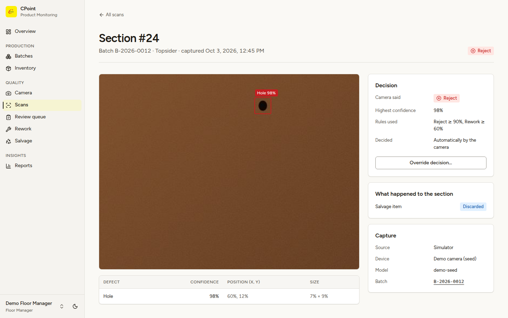
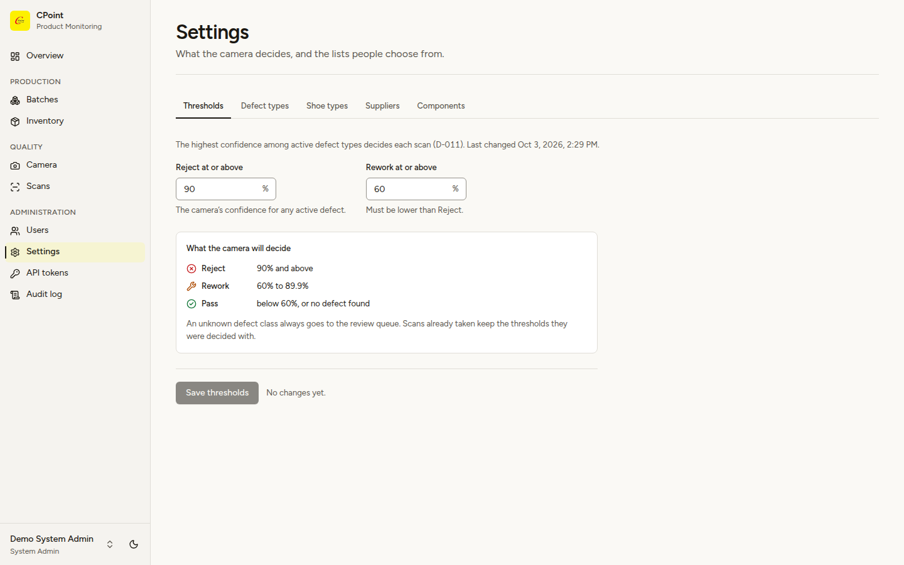
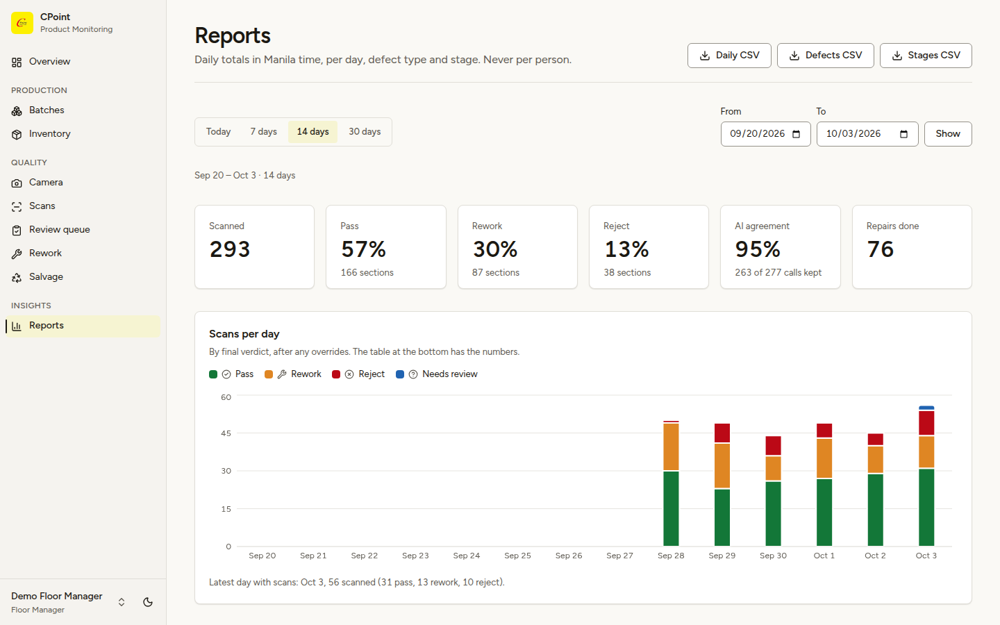
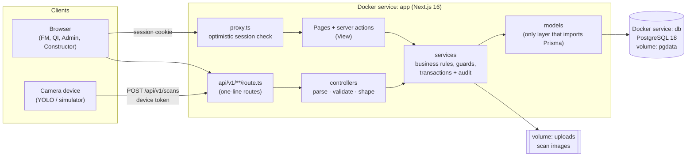
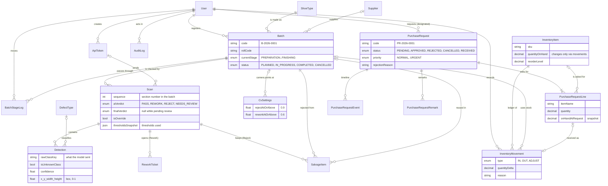

# CPoint Product Monitoring System

Product Monitoring System for **CPoint Shoe Store Corporation**'s leather-shoe production line
(school shoes and topsiders). It replaces paper tally sheets with one shared view of the line:

- **Batches:** each one is a leather roll. A batch moves through **Preparation → Upper Making →
  Sole-ing → Finishing**, and the system records who moved it and when.
- **Camera checkpoint:** a computer-vision camera at Preparation checks each leather section
  before it is cut and calls it **Pass / Rework / Reject**. Unknown defects go to the Quality
  Inspector to decide. A person can override the camera's automatic calls.
- **Rework and salvage:** reworked sections go to the repair station board. Rejected leather is
  kept as salvage for another batch rather than thrown away.
- **Inventory:** leather rolls and supplies are tracked through an audited ledger, with low-stock
  alerts.
- **Procurement:** designated Shoe Constructors request materials when they run low. The Floor
  Manager approves or rejects each request, then marks it received, which adds the stock to
  inventory.
- **Reports:** daily totals, defects by type, how often people kept the camera's call, and time
  per stage (the bottleneck), with CSV for Excel. Nothing is ranked per person.


> BS-IT capstone project. Progress is in [`docs/STATUS.md`](docs/STATUS.md), the plan in
> [`docs/ROADMAP.md`](docs/ROADMAP.md), and every design decision with its reason in
> [`docs/DECISIONS.md`](docs/DECISIONS.md).

## Contents

- [Quick start: demo / factory machine](#quick-start-demo--factory-machine) (Docker only)
- [Demo script](#demo-script) (10 minutes, per role)
- [Architecture](#architecture) and [data model](#data-model)
- [Quick start: development](#quick-start-development)
- [Environment](#environment), [Camera and simulator](#camera-and-simulator), [Scripts](#scripts)

## Tech stack

Next.js 16 (App Router, TypeScript strict) · PostgreSQL 18 · Prisma 7 · Tailwind CSS 4 +
shadcn/ui (Radix) · Zod · Recharts · Vitest + Playwright (+ axe) · Docker (one compose file, two
services) · GitHub Actions CI.

## Quick start: demo / factory machine

Runs the whole system in Docker. The machine needs only **Docker Desktop** (or Docker Engine +
Compose v2) and this folder. No Node.js needed.

1. Create the settings file:

   ```bash
   cp .env.example .env
   ```

   (Windows PowerShell: `Copy-Item .env.example .env`.)

2. Open `.env` in a text editor and fill in:

   | Line                        | Put                                                                                       |
   | --------------------------- | ----------------------------------------------------------------------------------------- |
   | `AUTH_SECRET=`              | A long random string. `openssl rand -base64 32` makes one, or type 40+ random characters. |
   | `BOOTSTRAP_ADMIN_PASSWORD=` | 12+ characters. Used only when no System Admin exists yet (demo off).                     |
   | `DEMO_USER_PASSWORD=`       | 8+ characters. The password for all four demo accounts.                                   |
   | `SEED_DEMO_WEEK=false`      | Change to `true` for a panel demo: a past week of production is created on first start.   |

   For real use, also change `POSTGRES_PASSWORD` and set `SEED_DEMO_USERS=false`.

3. Build and start:

   ```bash
   docker compose up --build -d
   ```

   The first build takes a few minutes. On start, the app container applies database migrations,
   seeds the reference data and accounts, then starts the server.

4. Open <http://localhost:3000> (or `http://<this-machine's-LAN-IP>:3000` from another PC on the
   network) and sign in with one of the demo accounts below.

   With `SEED_DEMO_WEEK=true`, the demo week is written in the background during the first
   minute. Refresh the home page after about 30 seconds. It runs only while the database has no
   batches, so restarts never add a second week.

`docker compose ps` shows both services as `healthy` once ready, and
`docker compose logs -f app` shows the logs. Stop with `docker compose down`. Add `-v` only to
**delete all data** (both volumes).

| Container | What it is                                 | Data volume             |
| --------- | ------------------------------------------ | ----------------------- |
| `app`     | Next.js server (non-root), runs migrations | `uploads` (scan images) |
| `db`      | PostgreSQL 18                              | `pgdata`                |

**Demo accounts** (created on start when `SEED_DEMO_USERS=true`). All four use
`DEMO_USER_PASSWORD`, including `admin@cpoint.local`. `BOOTSTRAP_ADMIN_PASSWORD` is used only
when there is no admin account yet, as on a real install with demo users off.

| Role              | Email                      | Lands on             | Does                                                                             |
| ----------------- | -------------------------- | -------------------- | -------------------------------------------------------------------------------- |
| Floor Manager     | `manager@cpoint.local`     | `/floor-manager`     | Batches, stages, rework, salvage, inventory, purchase request decisions, reports |
| Quality Inspector | `inspector@cpoint.local`   | `/quality-inspector` | Decides flagged scans (review queue), overrides, rework, quality reports         |
| System Admin      | `admin@cpoint.local`       | `/admin`             | Users, thresholds, defect types, tokens, audit, who can request materials        |
| Shoe Constructor  | `constructor@cpoint.local` | `/constructor`       | Sends purchase requests (designated requester)                                   |

## Demo script

About twelve minutes with the demo week loaded (`SEED_DEMO_WEEK=true`). Use two browser windows
(or one normal and one private) to show two roles side by side.

### 1. Floor Manager (4 min)

1. **Home** (`manager@cpoint.local`): batches by stage, with **Upper Making** marked as the
   longest wait. Also today's inspection split, open repairs, low stock (Contact cement), the
   daily summary, and **purchase requests** waiting for a decision (one urgent).
2. **Batches → B-2026-0011:** the stage stepper and timeline (who moved it, when, and how long
   each stage took). The **Yield** card shows usable sections = passed + repaired, and how many
   went to the repair station and to salvage.

   

3. **New batch:** register a roll (it can be taken from inventory), then **Start production**.
   The batch is now at Preparation, so the camera's scans go to it.
4. **Camera:** shows which batch is receiving scans. To show live scans, run the simulator from a
   development checkout (see [Camera and simulator](#camera-and-simulator)). They appear on the
   home page within seconds.
5. **Rework board:** Waiting → Being repaired → Repaired. Each step is one click, with undo.
6. **Salvage:** rejected sections are kept. **Use in batch** assigns one to another open batch;
   **Discard** needs a reason.
7. **Inventory → Contact cement:** the ledger. Stock changes only through recorded movements
   (deliveries, use, counts), and undo is a reversal entry, never an edit.
8. **Reports:** the scans-per-day chart, defects by type, camera call vs final verdict, and time
   in each stage, where Upper Making is the **bottleneck**. Download **Daily CSV** and open it in
   Excel.

### 2. Quality Inspector (3 min)

1. **Review queue** (`inspector@cpoint.local`): two scans with an unknown defect class
   ("scratch") wait for a person. Decide one: **Pass / Rework / Reject**.

   

   Only the Quality Inspector decides these (D-028). The Floor Manager sees the same queue, but
   read-only: "Waiting for a Quality Inspector".

2. Open one of **today's automatic Rework and Reject** calls. The image shows the camera's box
   and confidence. **Override decision…** asks for a reason, and the scan then shows both calls
   (the camera's is struck through).

   

3. **Reports → Camera call vs final verdict:** the off-diagonal numbers are overrides. A high
   agreement (about 95% in the demo week) means the thresholds suit the line.

### 3. Shoe Constructor → Floor Manager: a purchase request (2 min)

1. **Constructor home** (`constructor@cpoint.local`): their open requests. **New request**: pick
   **Contact cement** (the picker shows it's low, and that PR-… already asks for it), 2 cans,
   mark it **Urgent**, say why, and send it. Requests can't be edited afterwards: cancel and
   resend.
2. **Floor Manager → Procurement:** the **Pending** tab, urgent first, with how long each has
   waited. Open the request: the stock **when asked** sits next to the stock **now**.

   

3. **Approve** with a note, or **Reject…** with a reason the constructor will see. Open the
   approved request from earlier in the week and **Mark received…**: the dialog lists what goes
   into stock, and Inventory shows the delivery in the ledger ("Received for PR-…").
4. The **timeline** and **remarks** on the request show who did what and when. The **Requesters**
   tab chooses who may send requests. A change applies on that person's next click.

### 4. System Admin (2 min)

1. **Settings → Thresholds** (`admin@cpoint.local`): Reject at 90% or above, Rework from 60%,
   with a preview of what the camera will decide. Changes apply to new scans only. Old scans keep
   the thresholds they were decided with.

   

2. **Settings → Defect types:** "scratch" is listed as an **unknown class** the camera has sent.
   Adding it as a defect type is a data change, not a code change.
3. **Users:** add a person, who gets a one-time temporary password. **API tokens:** each camera
   machine has its own token, which can only send scans.
4. **Audit log:** every change above, plus every sign-in, with before/after values.

### Talking points

- **The decision rule (D-011):** the highest confidence among known defects decides. ≥ 90% →
  Reject, 60–89% → Rework, below 60% → Pass. An unknown class always goes to a person. The
  thresholds are data the admin can change.
- **People stay in charge:** the camera's calls can be overridden with a reason, and the reports
  show how often that happens. Flagged scans are the Quality Inspector's to decide (D-028).
- **Requests close the loop with stock:** an approved request, once received, posts the delivery
  into the inventory ledger. Nobody orders twice: Inventory marks items already requested.
- **No per-person rankings or scores** anywhere (from the client survey). Reports aggregate by
  day, stage and defect only.
- **Nothing is deleted:** stock moves through a ledger, rejected leather becomes salvage, and
  every change is in the audit log.



## Architecture



- **MVC layering, enforced by ESLint:** a page that imports a model, or a component that imports
  server code, fails `npm run lint`.
- **Access:**
  - Every page calls `requireRole`/`requirePermission` and every API route calls
    `requireApiPermission`. The proxy is only a fast first check.
  - Permissions are a role × permission matrix in `src/server/policies`.
- **Every mutation** runs in one database transaction and writes an audit row in that same
  transaction.

## Data model

The core tables (`prisma/schema.prisma` has all of them, with indexes). Ids are UUIDv7.



## Quick start: development

Use this setup when working on the code: Next.js runs on your machine with hot reload, and
PostgreSQL runs in Docker. Run commands one at a time and continue only when each succeeds.

### 1. Check the prerequisites

Install Node.js **22.12 or newer** (24 LTS recommended) and Docker Desktop. Open Docker Desktop
and wait until its engine is running. In a terminal, check:

```cmd
node --version
npm --version
docker --version
docker compose version
```

If a command is not recognized, install the corresponding tool or check its PATH, then reopen
the terminal. Use the same Node.js LTS version across the team where possible.

### 2. Open the repository folder

If you have not cloned the repository yet:

```cmd
git clone https://github.com/OatiesMilk/CPoint-PMS.git
cd CPoint-PMS
```

If you already have it, open a terminal in that folder. For example, in Windows Command Prompt
(replace the path with your own):

```cmd
cd /d C:\path\to\CPoint-PMS
```

### 3. Create and configure `.env`

On a new checkout, copy the settings template. In **Windows Command Prompt**:

```cmd
copy .env.example .env
notepad .env
```

In **PowerShell**, use `Copy-Item .env.example .env`; on **macOS/Linux**, use
`cp .env.example .env`. If `.env` already exists, edit it instead of overwriting it.

Generate a secret with Node.js (works in Command Prompt, PowerShell and macOS/Linux terminals):

```bash
node -e "console.log(require('crypto').randomBytes(32).toString('base64'))"
```

Paste the generated value after `AUTH_SECRET=` in `.env`. Fill in these settings before starting
Docker or the app:

| Setting                    | Value for local development                                                    |
| -------------------------- | ------------------------------------------------------------------------------ |
| `AUTH_SECRET`              | The generated random secret; at least 32 characters.                           |
| `BOOTSTRAP_ADMIN_PASSWORD` | Your chosen password, at least 12 characters.                                  |
| `DEMO_USER_PASSWORD`       | Your chosen password, at least 8 characters; used by all four demo accounts.   |
| `SEED_DEMO_USERS`          | `true` to create the demo accounts.                                            |
| `SEED_DEMO_WEEK`           | `true` for sample production data, or `false` for an empty production dataset. |

Use actual values, not placeholder text, and save the file. Keep the database values from
`.env.example` for the default local setup. Each teammate should create their own `.env`; keep
secrets out of Git and shared terminal output.

### 4. Install dependencies and start the database

Run these from the repository root:

```bash
npm ci
npm run db:up
npm run db:deploy
```

`npm ci` installs the versions in `package-lock.json` and generates the Prisma client.
`db:up` starts PostgreSQL; `db:deploy` applies the committed database migrations. If the database
is still starting when migration fails, check `docker compose ps`, wait for `db` to be healthy,
and retry `npm run db:deploy`.

### 5. Start the app and sign in

```bash
npm run dev
```

Leave this terminal running and open <http://localhost:3000>. The app seeds reference data and
demo accounts during startup. Sign in with `manager@cpoint.local` and the `DEMO_USER_PASSWORD`
you saved in `.env`. The other accounts are `inspector@cpoint.local`, `admin@cpoint.local`, and
`constructor@cpoint.local`; all use that same demo password.

With `SEED_DEMO_WEEK=true`, sample production data loads in the background on first startup.
Refresh after about a minute. It only seeds when there are no batches. Alternatively, run
`npm run demo:seed` in a second terminal after startup.

### Troubleshooting and stopping

- **`Invalid environment variables ... AUTH_SECRET`:** `.env` must contain a real secret of at
  least 32 characters. Generate it with the Node.js command above, replace the `AUTH_SECRET=`
  value, and save. Stop the app with **Ctrl+C**, then run `npm run dev` again. A `Ready` message
  or a working login page does not mean startup seeding succeeded; check for bootstrap errors.
- **Other invalid environment variables:** check the named setting against `.env.example` and
  the minimum password lengths above, save, and restart the app.
- **Docker connection error:** open Docker Desktop and wait for the engine, then retry
  `npm run db:up`.
- **Database connection error:** check `docker compose ps` and `docker compose logs db`, confirm
  the database is healthy, and check that `DATABASE_URL` matches the PostgreSQL settings.
- **Port 5432 is already occupied:** change `DB_PORT` in `.env` and the port in `DATABASE_URL`
  to the same free port, then run `npm run db:up` again.

Stop the app with **Ctrl+C**. Stop the database with `npm run db:down`; its data stays in the
Docker volume. On later runs, use `npm run db:up` followed by `npm run dev`. After pulling new
changes, run `npm ci` if dependencies changed and `npm run db:deploy` for new migrations before
starting the app.

## Environment

`.env.example` lists every variable with a comment. These need a value:

| Variable                   | What to put                                                                                                                                                                                |
| -------------------------- | ------------------------------------------------------------------------------------------------------------------------------------------------------------------------------------------ |
| `AUTH_SECRET`              | A random secret that signs sessions: `openssl rand -base64 32`. One per machine.                                                                                                           |
| `BOOTSTRAP_ADMIN_PASSWORD` | 12+ characters. Creates the first System Admin (`BOOTSTRAP_ADMIN_EMAIL`) if no active admin exists. With demo users on, `admin@cpoint.local` already exists and uses `DEMO_USER_PASSWORD`. |
| `DEMO_USER_PASSWORD`       | 8+ characters. Password for the demo accounts (when `SEED_DEMO_USERS=true`).                                                                                                               |
| `SEED_DEMO_WEEK`           | `true` to create a past week of production on first start (panel demo). Default off.                                                                                                       |

On every start the app makes sure the reference data exists: shoe types, defect types, CV
thresholds 90% / 60%, and a sample supplier. It never overwrites values an admin has changed.
With demo users on, it also adds five demo inventory items the first time.
`npm run db:seed` runs the same steps by hand.

**The demo week** (`SEED_DEMO_WEEK=true` or `npm run demo:seed`) replays the last six working
days through the real services:

- 14 batches across all stages, with realistic stage times (Upper Making is the slowest);
- about 290 scans with images;
- overrides, repairs, salvage, deliveries and stock use, plus two scans left for review.

It uses a fixed random seed, so it shows the same shape every time. It never runs on a database
that already has batches.

**Sign-in rules:**

- 5 wrong passwords lock an account for 15 minutes.
- Sessions last 12 hours (one shift).
- A deactivated user is signed out on their next click.
- Signing out ends the session on the server.
- Every sign-in, failure and sign-out is in the audit log.

**Accounts:** the System Admin adds people under **Users**. Each new account and each password
reset gets a temporary password that is shown once, and the person chooses their own at first
sign-in.

## Camera and simulator

The Preparation camera (later the YOLO service on a phone, webcam or dedicated camera) sends each
capture to `POST /api/v1/scans` with a **device token** (contract in [`docs/API.md`](docs/API.md)).
Without a camera, the simulator sends realistic scans through the same API from a development
checkout:

```bash
npm run cv:token -- --name "Simulator"   # prints a token once; put it in .env as CV_DEVICE_TOKEN
# start a batch (Batches → New batch → Start production), then:
npm run cv:simulate -- --count 20 --interval 3
```

The simulator can also point at the Docker stack (`CV_BASE_URL=http://localhost:3000`). Create the
token there under **Admin → API tokens**.

Scans go to the batch chosen on the **Camera** page, or to the batch that has been at Preparation
the longest. They show up live on the Floor Manager and Quality Inspector homes.

## Scripts

| Command                     | What it does                                                             |
| --------------------------- | ------------------------------------------------------------------------ |
| `npm run dev`               | Dev server with hot reload                                               |
| `npm run check`             | lint + typecheck + unit tests + build (run before pushing)               |
| `npm run lint`              | ESLint, including the MVC layer import rules                             |
| `npm run typecheck`         | Generate route types, then `tsc --noEmit`                                |
| `npm run test`              | Unit tests (Vitest)                                                      |
| `npm run test:e2e`          | Browser tests (Playwright + axe). Needs `npm run build` and the database |
| `npm run format`            | Prettier                                                                 |
| `npm run db:up` / `db:down` | Start/stop PostgreSQL in Docker                                          |
| `npm run db:migrate`        | Create + apply a migration after editing `prisma/schema.prisma`          |
| `npm run db:deploy`         | Apply pending migrations                                                 |
| `npm run db:seed`           | Seed reference data, demo users and the bootstrap admin (idempotent)     |
| `npm run demo:seed`         | Seed a past week of production (only when there are no batches)          |
| `npm run cv:token`          | Create a camera device token (printed once)                              |
| `npm run cv:simulate`       | Send simulated camera scans (`--count`, `--interval`, `--batch`)         |
| `npm run db:studio`         | Browse the database in Prisma Studio                                     |

First time running e2e: `npx playwright install chromium`. If Chromium is already installed
elsewhere, set `PLAYWRIGHT_CHROMIUM_PATH=/path/to/chrome` instead. To test the Docker stack, set
`E2E_BASE_URL=http://localhost:3000`.

## Project structure (MVC)

```
src/
  app/                 VIEW: pages and layouts, one folder per area
    api/v1/**/route.ts ROUTES: one-line files that hand off to a controller
  server/
    controllers/       CONTROLLER: parse/validate request → call service → shape response
    services/          business rules (decision engine, stage flow, ledger, reports, demo seed)
    models/            MODEL: data access; the only layer that imports Prisma
    validators/        Zod schemas shared by API and forms
    policies/          who can do what (role × permission), page and API guards
    lib/               env, Prisma client, logger, errors, HTTP helpers
  components/ui/       shadcn-style primitives, styled with design tokens
  components/features/ feature components (VerdictBadge, charts, app shell, ...)
  styles/tokens.css    design tokens (see DESIGN.md)
prisma/                schema, migrations, seed
tests/unit, tests/e2e  Vitest and Playwright tests (including a smoke test per role)
docker/                container entrypoint
docs/                  status, roadmap, decisions, API, UI audit, client survey, screenshots
```

## Quality checks

- **CI** (GitHub Actions) runs lint, typecheck, unit tests, the build and the e2e suite. It also
  builds the Docker stack, checks the demo week seeds once, and checks the stock ledger adds up.
- **Accessibility:** the e2e smoke test runs axe (WCAG 2.1 A/AA) on every page of every role.
- **UI audit:** the findings and their fixes are in [`docs/UI_AUDIT.md`](docs/UI_AUDIT.md).

## API

All endpoints are documented in [`docs/API.md`](docs/API.md). Errors always use one shape:
`{ "error": { "code", "message", "details?" } }`.

## Working with Claude Code

This project is built with Claude Code, one roadmap phase per session. Start with `/resume` and
finish with `/wrap-up`. See [`docs/AGENTIC_WORKFLOW.md`](docs/AGENTIC_WORKFLOW.md).

## Design

Visual language, tokens and UI rules are in [`DESIGN.md`](DESIGN.md).
