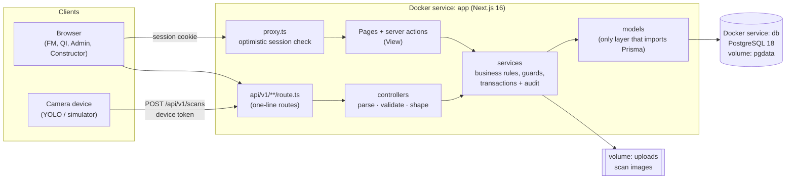
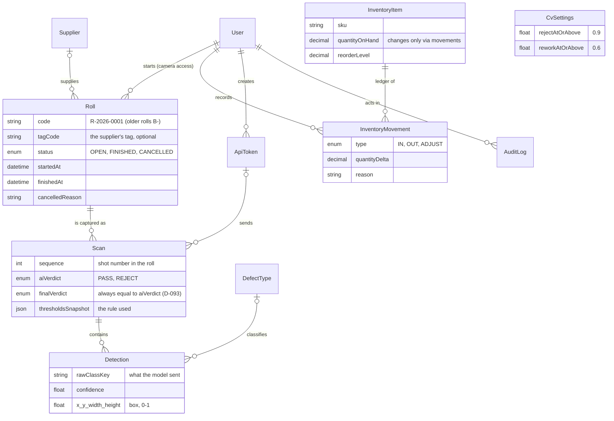

# CPoint Product Monitoring System

Product Monitoring System for **CPoint Shoe Store Corporation**'s leather-shoe production line
(school shoes and topsiders, counted together). It replaces paper tally sheets with one shared view of the line:

- **Rolls at Capture:** a Shoe Constructor with camera access starts each leather roll on their
  own phone, captures it shot by shot and finishes it once all of it is in (Phase 26). The Floor
  Manager reads every roll in **Reports → Rolls**.
- **Camera checkpoint:** the app's model checks each shot before cutting and calls it **Pass** or
  **Reject**; the verdict is final (D-093). Rejected parts are reported for salvage.
- **Inventory:** leather rolls and supplies are tracked through an audited ledger, with low-stock
  alerts.
- **Batches:** the working day is split into batches, one per check-in interval (every 4 hours by
  default, with lunch left out: 08:00–13:00 and 13:00–17:00). The Quality Inspector finishes each
  batch on a phone with the pairs finished and how many failed inspection, prompted by an
  on-screen notice. The Floor Manager sets how often and one daily quota (with a suggestion from
  recent days) and sees each day's passed pairs against it, with the Shoe Constructors present
  from attendance and one sentence for every short day. The System Admin sets the lunch break.
- **Reports:** production against the quota, daily totals, defects by type, how often people kept
  the camera's call, supplier quality, with CSV for Excel. Nothing is ranked per person.


> BS-IT capstone project. Progress is in [`docs/STATUS.md`](docs/STATUS.md), the plan in
> [`docs/ROADMAP.md`](docs/ROADMAP.md), and every design decision with its reason in
> [`docs/DECISIONS.md`](docs/DECISIONS.md).

## Contents

- [Quick start: demo / factory machine](#quick-start-demo--factory-machine) (Docker only)
- [Demo script](#demo-script) (10 minutes, per role)
- [Architecture](#architecture) and [data model](#data-model)
- [Quick start: development](#quick-start-development)
- [Environment](#environment), [Camera and simulator](#camera-and-simulator),
  [Capture from the website](#capture-from-the-website), [Scripts](#scripts)
- [Keeping the folder small](#keeping-the-folder-small)

## Tech stack

Next.js 16 (App Router, TypeScript strict) · PostgreSQL 18 · Prisma 7 · Tailwind CSS 4 +
shadcn/ui (Radix) · Zod · Recharts · Vitest + Playwright (+ axe) · Docker (one compose file, two
services) · GitHub Actions CI.

## Quick start: demo / factory machine

Runs the whole system in Docker. The machine needs only **Docker Desktop** (or Docker Engine +
Compose v2) and this folder. No Node.js needed.

1. Create the settings file:

   ```bash
   cp .env.example .env
   ```

   (Windows PowerShell: `Copy-Item .env.example .env`.)

2. Open `.env` in a text editor and fill in:

   | Line                        | Put                                                                                       |
   | --------------------------- | ----------------------------------------------------------------------------------------- |
   | `AUTH_SECRET=`              | A long random string. `openssl rand -base64 32` makes one, or type 40+ random characters. |
   | `BOOTSTRAP_ADMIN_PASSWORD=` | 12+ characters. Used only when no System Admin exists yet (demo off).                     |
   | `DEMO_USER_PASSWORD=`       | 8+ characters. The password for all four demo accounts.                                   |
   | `SEED_DEMO_WEEK=false`      | Change to `true` for a panel demo: a past week of production is created on first start.   |

   For real use, also change `POSTGRES_PASSWORD` and set `SEED_DEMO_USERS=false`.

3. Build and start:

   ```bash
   docker compose up --build -d
   ```

   The first build takes a few minutes. On start, the app container applies database migrations,
   seeds the reference data and accounts, then starts the server.

4. Open <http://localhost:3000> (or `http://<this-machine's-LAN-IP>:3000` from another PC on the
   network) and sign in with one of the demo accounts below.

   With `SEED_DEMO_WEEK=true`, the demo week is written in the background during the first
   minute. Refresh the home page after about 30 seconds. It runs only while the database has no
   rolls, so restarts never add a second week.

The Capture page (scanning from the browser) also needs the model files in `cv/models/`: see
[Capture from the website](#capture-from-the-website). Other devices reach the site through a
Cloudflare Tunnel (same section).

`docker compose ps` shows both services as `healthy` once ready, and
`docker compose logs -f app` shows the logs. Stop with `docker compose down`. Add `-v` only to
**delete all data** (both volumes).

| Container | What it is                                 | Data volume             |
| --------- | ------------------------------------------ | ----------------------- |
| `app`     | Next.js server (non-root), runs migrations | `uploads` (scan images) |
| `db`      | PostgreSQL 18                              | `pgdata`                |

**Demo accounts** (created on start when `SEED_DEMO_USERS=true`). All four use
`DEMO_USER_PASSWORD`, including `admin@cpoint.local`. `BOOTSTRAP_ADMIN_PASSWORD` is used only
when there is no admin account yet, as on a real install with demo users off.

| Role              | Email                      | Lands on             | Does                                                                                     |
| ----------------- | -------------------------- | -------------------- | ---------------------------------------------------------------------------------------- |
| Floor Manager     | `manager@cpoint.local`     | `/floor-manager`     | Batch plan and quota, attendance, inventory, reports (Rolls: read, cancel with a reason) |
| Quality Inspector | `inspector@cpoint.local`   | `/quality-inspector` | Finishes each batch (pairs finished and failed), follows the scans                       |
| System Admin      | `admin@cpoint.local`       | `/admin`             | Users (camera access), found-at value, defect types, lunch break, tokens, audit          |
| Shoe Constructor  | `constructor@cpoint.local` | `/camera/capture`    | Starts, captures and finishes rolls on their phone once given camera access (D-095)      |

Twelve more **demo Shoe Constructors** (Ana Cruz, Ben Santos and others, `@cpoint.local`) are
created with them so Attendance has a believable roster. They have random passwords and never sign
in (D-081). The demo week gives camera access to Noel Manalo (`constructor@`) and three of them,
who capture its rolls.

## Demo script

About ten minutes with the demo week loaded (`SEED_DEMO_WEEK=true`). Use two browser windows
(or one normal and one private) to show two roles side by side. Each role sees only its own pages
(D-100): the FM Overview, Batches, Attendance, Reports and Inventory; the QI Batches; the Admin the
administration pages and Camera; a constructor Capture.

**Demo tools (optional, D-101):** with `DEMO_LOGIN_TOOLS=true` (and `SEED_DEMO_USERS=true`) the
login page has **Demo sign-in**, one button per role, and **Reset demo data** (type RESET; about a
minute; "Fresh demo week loaded."). A **Demo mode** band shows on every page. Never turn it on for
real use.

### 1. Floor Manager (4 min)

1. **Home** (`manager@cpoint.local`): **Today's batches** (passed pairs against the daily quota,
   the batch under way), the **Attendance** card (today is "Not taken yet"), **Rolls today**
   (sections checked, rejected for salvage, rolls still open), low stock (Contact cement), the
   daily summary.
2. **Batches:** today's two batches (08:00–13:00 with lunch 11:00–12:00, and 13:00–17:00) and the
   **Recent days** chart and table: three days fell short on passed pairs, each with its sentence,
   "Below quota by 18 pairs. 3 of 12 Shoe Constructors were absent." Nothing names a person.
   **Plan batches and quota** sets how often (every 1 to 4 hours, or once at the end of the day)
   with a preview of tomorrow's batches, and the one daily quota with its suggestion; **Use
   suggestion** fills it in.
3. **Inventory → Black cowhide (school shoes):** the item's **Rolls**, each with its own code
   (`LR-MT-001`), area, status (Not scanned, Being scanned, Scanned, Fully used, Removed), shots
   and defects found. **Add rolls**: the day they arrived, then each roll's area. The count on hand
   follows the rolls (Phase 30A, D-103, D-104).
   **Reports → Rolls:** every roll, newest first, with its supplier, area, shots, passed and
   rejected (for salvage). The newest scan is still **Being scanned**; one shelf roll was
   **Removed** by the Floor Manager with a reason. Open a finished roll: each shot with its photo, verdict and
   defects, and a **Claim sheet**. No constructor is named.

4. **Attendance** (Production → Attendance): **Mark everyone present**, untick two people, and
   **Save attendance**. The summary reads "10 of 12 Shoe Constructors present"; the home card
   follows. **Previous day** shows the demo week's days, a few with absences. It is a one-day log
   book: no per-person history or counts anywhere (D-008, D-077).
5. **Capture on a phone** (`constructor@cpoint.local`, in a phone-sized window): Capture is the
   only page. **Scan this roll** on a roll from Inventory, then **Capture**: green Pass or red
   Reject for each shot, each defect Usable or Not accepted. **Finish roll** once all of it is in.
6. To show live scans without a phone, run the simulator from a development checkout (see
   [Camera and simulator](#camera-and-simulator)); the System Admin's **Camera** page shows them.
7. **Repair Station:** To handle → Being handled → Done, usable. Each card says what the
   section needs (Clean before cutting, or Cut around the marked area). Each step is one click,
   with undo.
8. **Salvage:** rejected sections are kept. **Use in batch** assigns one to another open batch;
   **Discard** needs a reason.
9. **Inventory → Contact cement:** the ledger. Stock changes only through recorded movements
   (deliveries, use, counts), and undo is a reversal entry, never an edit.
10. **Reports → Operations:** pairs finished, failed inspection and the share of quota, the
    **Production** section with
    the same short days, and "3 of the last 5 working days were below quota" under what needs
    attention. Download **Production CSV** and open it in Excel.
11. **Reports → Operations → Supplier quality:** each supplier's rolls, Fixable % and Reject %, with
    **High** on the worst. Under **Rolls with the most rejects**, open a **Claim sheet** and
    **Save as PDF** to show the evidence for a supplier claim (D-072).

### 2. Quality Inspector (3 min)

1. **Batches on a phone** (`inspector@cpoint.local`, in a phone-sized window): near a batch's end
   a banner reads "Batch 2 ends at 17:00. Get ready to count the finished pairs.", and at the end
   "Batch 2 is due. Finish it now." with the bell and a "(1)" in the tab title. **Finish batch 2**:
   the pairs finished and, of these, the pairs that failed inspection, and tick any scanned roll
   that is **Fully used** (it leaves stock then). A second finish is refused; **Correct** needs a
   reason and can untick a roll.
2. **Review queue** (`inspector@cpoint.local`): two scans with an unknown defect class
   ("scratch") wait for a person. Decide one: **Pass / Fixable / Reject**.

   

   Only the Quality Inspector decides these (D-028). The Floor Manager sees the same queue, but
   read-only: "Waiting for a Quality Inspector".

3. Open one of **today's automatic Fixable and Reject** calls. The image shows the camera's box
   and confidence. **Override decision…** asks for a reason, and the scan then shows both calls
   (the camera's is struck through).

   

4. **Reports → Camera call vs final verdict:** the off-diagonal numbers are overrides. A high
   agreement (about 95% in the demo week) means the thresholds suit the line.

### 3. System Admin (2 min)

0. **Overview** (`admin@cpoint.local`): system health, users, the camera and the
   lunch break. **Camera:** the model, the last capture and how many rolls are open.
1. **Settings → Lunch break**: 11:00 to 12:00, applying from tomorrow, with
   its history. Lunch pauses the batch it falls in.

2. **Settings → Thresholds** (`admin@cpoint.local`): Reject at 90% or above, Fixable from 60%,
   with a preview of what the camera will decide. Changes apply to new scans only. Old scans keep
   the thresholds they were decided with.

   

3. **Settings → Defect types:** each class the model sends, Usable or Not accepted. A class with
   no defect type is ignored (D-108), so a retrained model's new classes are added here: a data
   change, not a code change.
4. **Users:** add a person, who gets a one-time temporary password. **API tokens:** each camera
   machine has its own token, which can only send scans.
5. **Audit log:** every change above, plus every sign-in, with before/after values.

### Talking points

- **The decision rule (D-011):** the highest confidence among known defects decides. ≥ 90% →
  Reject, 60–89% → Fixable, below 60% → Pass. A class with no defect type is ignored (D-108). The
  thresholds are data the admin can change.
- **People stay in charge:** the camera's calls can be overridden with a reason, and the reports
  show how often that happens. Flagged scans are the Quality Inspector's to decide (D-028).
- **No per-person rankings or scores** anywhere (from the client survey). Reports aggregate by
  day, batch and defect only; a short day is explained by how many were absent, never who.
- **Nothing is deleted:** stock moves through a ledger, rejected leather becomes salvage, and
  every change is in the audit log.


## Architecture



- **MVC layering, enforced by ESLint:** a page that imports a model, or a component that imports
  server code, fails `npm run lint`.
- **Access:**
  - Every page calls `requireRole`/`requirePermission` and every API route calls
    `requireApiPermission`. The proxy is only a fast first check.
  - Permissions are a role × permission matrix in `src/server/policies`.
- **Every mutation** runs in one database transaction and writes an audit row in that same
  transaction.

## Data model

The core tables (`prisma/schema.prisma` has all of them, with indexes). Ids are UUIDv7.



## Quick start: development

Use this setup when working on the code: Next.js runs on your machine with hot reload, and
PostgreSQL runs in Docker. Run commands one at a time and continue only when each succeeds.

### 1. Check the prerequisites

Install Node.js **22.12 or newer** (24 LTS recommended) and Docker Desktop. Open Docker Desktop
and wait until its engine is running. In a terminal, check:

```cmd
node --version
npm --version
docker --version
docker compose version
```

If a command is not recognized, install the corresponding tool or check its PATH, then reopen
the terminal. Use the same Node.js LTS version across the team where possible.

### 2. Open the repository folder

If you have not cloned the repository yet:

```cmd
cd /d C:\dev
git clone https://github.com/OatiesMilk/CPoint-PMS.git
cd CPoint-PMS
```

Clone it into a folder that OneDrive, Dropbox or Google Drive doesn't sync, such as `C:\dev`
(make it first with `mkdir C:\dev`). The installed tools add about 90,000 files; see [Keeping the
folder small](#keeping-the-folder-small).

If you already have it, open a terminal in that folder. For example, in Windows Command Prompt
(replace the path with your own):

```cmd
cd /d C:\path\to\CPoint-PMS
```

### 3. Create and configure `.env`

On a new checkout, copy the settings template. In **Windows Command Prompt**:

```cmd
copy .env.example .env
notepad .env
```

In **PowerShell**, use `Copy-Item .env.example .env`; on **macOS/Linux**, use
`cp .env.example .env`. If `.env` already exists, edit it instead of overwriting it.

Generate a secret with Node.js (works in Command Prompt, PowerShell and macOS/Linux terminals):

```bash
node -e "console.log(require('crypto').randomBytes(32).toString('base64'))"
```

Paste the generated value after `AUTH_SECRET=` in `.env`. Fill in these settings before starting
Docker or the app:

| Setting                    | Value for local development                                                                                                                                              |
| -------------------------- | ------------------------------------------------------------------------------------------------------------------------------------------------------------------------ |
| `AUTH_SECRET`              | The generated random secret; at least 32 characters.                                                                                                                     |
| `BOOTSTRAP_ADMIN_PASSWORD` | Your chosen password, at least 12 characters.                                                                                                                            |
| `DEMO_USER_PASSWORD`       | Your chosen password, at least 8 characters; used by all four demo accounts.                                                                                             |
| `SEED_DEMO_USERS`          | `true` to create the demo accounts.                                                                                                                                      |
| `DEMO_LOGIN_TOOLS`         | `true` for the demo sign-in buttons and Reset demo data on the login page, with a Demo mode band (D-101). Needs `SEED_DEMO_USERS=true`. Never for real use. Default off. |
| `SEED_DEMO_WEEK`           | `true` for sample production data, or `false` for an empty production dataset.                                                                                           |

Use actual values, not placeholder text, and save the file. Keep the database values from
`.env.example` for the default local setup. Each teammate should create their own `.env`; keep
secrets out of Git and shared terminal output.

### 4. Install dependencies and start the database

Run these from the repository root:

```bash
npm ci
npm run db:up
npm run db:deploy
```

`npm ci` installs the versions in `package-lock.json` and generates the Prisma client.
`db:up` starts PostgreSQL; `db:deploy` applies the committed database migrations. If the database
is still starting when migration fails, check `docker compose ps`, wait for `db` to be healthy,
and retry `npm run db:deploy`.

### 5. Start the app and sign in

```bash
npm run dev
```

Leave this terminal running and open <http://localhost:3000>. The app seeds reference data and
demo accounts during startup. Sign in with `manager@cpoint.local` and the `DEMO_USER_PASSWORD`
you saved in `.env`. The other accounts are `inspector@cpoint.local`, `admin@cpoint.local`, and
`constructor@cpoint.local`; all use that same demo password.

With `SEED_DEMO_WEEK=true`, sample production data loads in the background on first startup.
Refresh after about a minute. It only seeds when there are no rolls. Alternatively, run
`npm run demo:seed` in a second terminal after startup.

### 6. The camera (optional)

To scan leather from the browser, follow [Capture from the website](#capture-from-the-website):
the model files, the defect types, and (to use a phone) an HTTPS certificate. Without them the
rest of the system works, and `npm run cv:simulate` sends test scans ([Camera and
simulator](#camera-and-simulator)).

### Troubleshooting and stopping

- **`Invalid environment variables ... AUTH_SECRET`:** `.env` must contain a real secret of at
  least 32 characters. Generate it with the Node.js command above, replace the `AUTH_SECRET=`
  value, and save. Stop the app with **Ctrl+C**, then run `npm run dev` again. A `Ready` message
  or a working login page does not mean startup seeding succeeded; check for bootstrap errors.
- **Other invalid environment variables:** check the named setting against `.env.example` and
  the minimum password lengths above, save, and restart the app.
- **Docker connection error:** open Docker Desktop and wait for the engine, then retry
  `npm run db:up`.
- **Database connection error:** check `docker compose ps` and `docker compose logs db`, confirm
  the database is healthy, and check that `DATABASE_URL` matches the PostgreSQL settings.
- **Port 5432 is already occupied:** change `DB_PORT` in `.env` and the port in `DATABASE_URL`
  to the same free port, then run `npm run db:up` again.

Stop the app with **Ctrl+C**. Stop the database with `npm run db:down`; its data stays in the
Docker volume. On later runs, use `npm run db:up` followed by `npm run dev`. After pulling new
changes, run `npm ci` if dependencies changed and `npm run db:deploy` for new migrations before
starting the app.

## Environment

`.env.example` lists every variable with a comment. These need a value:

| Variable                   | What to put                                                                                                                                                                                |
| -------------------------- | ------------------------------------------------------------------------------------------------------------------------------------------------------------------------------------------ |
| `AUTH_SECRET`              | A random secret that signs sessions: `openssl rand -base64 32`. One per machine.                                                                                                           |
| `BOOTSTRAP_ADMIN_PASSWORD` | 12+ characters. Creates the first System Admin (`BOOTSTRAP_ADMIN_EMAIL`) if no active admin exists. With demo users on, `admin@cpoint.local` already exists and uses `DEMO_USER_PASSWORD`. |
| `DEMO_USER_PASSWORD`       | 8+ characters. Password for the demo accounts (when `SEED_DEMO_USERS=true`).                                                                                                               |
| `DEMO_LOGIN_TOOLS`         | `true` for the demo sign-in and Reset demo data on the login page, with a Demo mode band (D-101). Needs `SEED_DEMO_USERS=true`. Never for real use. Default off.                           |
| `SEED_DEMO_WEEK`           | `true` to create a past week of production on first start (panel demo). Default off.                                                                                                       |

On every start the app makes sure the reference data exists: defect types, the batch schedule
and lunch break, CV
thresholds 90% / 60%, and a sample supplier. It never overwrites values an admin has changed.
With demo users on, it also adds five demo inventory items the first time.
`npm run db:seed` runs the same steps by hand.

**The demo week** (`SEED_DEMO_WEEK=true` or `npm run demo:seed`) replays the last six working
days through the real services:

- 14 rolls, each started at Preparation, scanned and finished (the newest is still at
  Preparation for the camera);
- about 290 scans with images;
- overrides, repairs, salvage, deliveries and stock use, plus two scans left for review;
- attendance for the working days before today, taken by the Floor Manager, with a few
  constructors absent on some days (today is left for you to take);
- one daily quota and the Quality Inspector finishing both batches a day (08:00–13:00 and
  13:00–17:00) with a pair or two failing inspection (one late, one missed); the three days with
  two or more absent end below quota on passed pairs.

It uses a fixed random seed, so it shows the same shape every time. It never runs on a database
that already has rolls.

**Sign-in rules:**

- 5 wrong passwords lock an account for 15 minutes.
- Sessions last 12 hours (one shift).
- A deactivated user is signed out on their next click.
- Signing out ends the session on the server.
- Every sign-in, failure and sign-out is in the audit log.

**Accounts:** the System Admin adds people under **Users**. Each new account and each password
reset gets a temporary password that is shown once, and the person chooses their own at first
sign-in.

## Camera and simulator

The Preparation camera (later the YOLO service on a phone, webcam or dedicated camera) sends each
capture to `POST /api/v1/scans` with a **device token** (contract in [`docs/API.md`](docs/API.md)).
Without a camera, the simulator sends realistic scans through the same API from a development
checkout:

```bash
npm run cv:token -- --name "Simulator"   # prints a token once; put it in .env as CV_DEVICE_TOKEN
# pick a roll at Capture (a constructor with camera access), then:
npm run cv:simulate -- --count 20 --interval 3
```

The simulator can also point at the Docker stack (`CV_BASE_URL=http://localhost:3000`). Create the
token there under **Admin → API tokens**.

Scans go to the roll given with `--roll <rollId>`, or to the roll open the longest. They show up
live on the Floor Manager and Quality Inspector homes.

The real model runs in the app itself, on the **Capture** page (see
[Capture from the website](#capture-from-the-website)). The camera station app and its `run` and
`doctor` commands were retired in Phase 20 (D-069). [`cv/`](cv/README.md) is now the model
toolkit: `predict` and `evaluate` try the model on photos, and `export-onnx` makes the files the
app runs. For yolo-v1, add the `crease` and `scratch` defect types in Settings first (D-052).
The model file lives in `cv/models/` and is never committed (D-049); see
[`cv/MODEL_CARD.md`](cv/MODEL_CARD.md).

## Capture from the website

The **Capture** page (a Shoe Constructor's only page, once the System Admin gives them camera
access, D-075 and D-095) does the camera's job in the browser, on their own phone: it shows the live camera, **Capture** (or Space) sends the frame on
screen, and the app runs the model itself and shows its verdict. No second application (Phase 18,
D-064 to D-067). It is the only way to capture since the station app was retired (D-069).

Every teammate does steps 1–2 once on their own machine. The machine that runs the app can then
use `http://localhost:3000/camera/capture`. Step 4 is for opening the site from **another device**
(a constructor's phone, the station PC, or a teammate's laptop).

### 1. Get the model files

The model is never in Git (D-049). The app needs two files in `cv/models/`:
`yolo-v1.onnx` and `yolo-v1.json`. Either:

- **ask Dylan for both files** (shared privately, not through GitHub) and copy them into
  `cv/models/`; or
- **make them yourself** from `yolo-v1.pt`, once `cv/.venv` is set up ([`cv/README.md`](cv/README.md),
  "Set up"):

  ```bash
  cd cv
  .venv/Scripts/python -m pip install -r requirements-export.txt
  .venv/Scripts/python -m cpoint_cv export-onnx
  ```

Restart the app after the files change. Without them the Capture page says "The camera model
isn't installed on the server" and Capture stays off; everything else works.

### 2. Set the defect types for the model

The model reports `crease`, `cut`, `hole` and `scratch`. A fresh database knows `cut`, `hole`,
`abrasion` and `dirt`, so `crease` and `scratch` would be rejected as unknown. Either
run `npm run demo:reset -- --yes` (**it deletes test data**: rolls and scans; the
accounts stay) or add the two types by hand under Admin → Settings → Defect types
([`cv/README.md`](cv/README.md), "Defect types for yolo-v1").

Now the page works on this machine: sign in as `constructor@cpoint.local` (the demo week gives
them camera access), open `http://localhost:3000/camera/capture` and **Scan this roll** on a roll the Floor Manager
added in Inventory.

### 3. Floor view at the station

At a station PC with a fixed webcam, an operator places each part of the roll and looks up at a
monitor. **Floor view** (the button next to Capture, D-074) fills the screen with the live camera
and the chosen roll. After each capture a thick coloured frame and a large band show the verdict,
the shot number and where the part goes:

| Verdict | Colour | Where it goes         |
| ------- | ------ | --------------------- |
| Pass    | Green  | On to cutting         |
| Reject  | Red    | Set aside for salvage |

It stays until the next capture. Esc leaves; the browser remembers the choice, so the station PC
opens straight into it (press F11 for full screen then). **Space** captures. The full setup
(phone on a stand, bins, each roll) is in [`docs/STATION_SETUP.md`](docs/STATION_SETUP.md).

Only Shoe Constructors capture: the System Admin gives camera access under Users (More actions →
**Give camera access**). Who captured a shot is kept in the audit log only, never on the scan or
in a report (D-008). They see the verdict and the shot, not Scans or Reports.

### 4. Reach the site with Cloudflare Tunnel (other devices)

Browsers only open the camera on `localhost` or an **HTTPS** address. A Cloudflare Tunnel gives the
app a real `https://` address with a trusted certificate, so any device's browser allows the
camera with no setup on that device (D-076). The tunnel runs on the server PC itself, next to
Docker, not as a third container. It's free.

1. Install `cloudflared` on the server PC: Windows `winget install Cloudflare.cloudflared`,
   macOS `brew install cloudflared` (Linux: see Cloudflare's downloads page).
2. **Staging / trying it out (quick tunnel, no account):** with the app running, run

   ```bash
   cloudflared tunnel --url http://localhost:3000
   ```

   It prints an address like `https://<random-words>.trycloudflare.com`. Open
   `…/camera/capture` there on the station PC. The address changes every time it restarts.
   With `npm run dev` instead of Docker, add that host to `DEV_ORIGINS` in `.env` first.

3. **The real setup (named tunnel):** a free Cloudflare account and a domain added to Cloudflare
   give a fixed address (e.g. `https://pms.<your-domain>`) that survives restarts. Follow
   Cloudflare's "Create a tunnel" guide and point it at `http://localhost:3000`.

Before you share a tunnel address, remember the site is public:

- revoke any device token that was ever pasted somewhere (Admin → API tokens) and make a new one;
- use strong values for `BOOTSTRAP_ADMIN_PASSWORD` and `DEMO_USER_PASSWORD`, or turn demo users
  off.

If the factory's internet drops, the tunnel and the station's capture stop with it. The server PC
itself keeps working at `http://localhost:3000`.

### If it doesn't work

| What you see                                                    | What to do                                                                                  |
| --------------------------------------------------------------- | ------------------------------------------------------------------------------------------- |
| "The camera only works on a secure address."                    | You opened `http://<an IP>` on another device. Use the tunnel's `https://` address (step 4) |
| The page loads through the tunnel but nothing reacts (dev only) | Add the tunnel's host to `DEV_ORIGINS` in `.env` and restart `npm run dev`                  |
| "The camera model isn't installed on the server."               | Step 1: both files in `cv/models/`, then restart the app                                    |
| "This browser isn't allowed to use the camera."                 | Click the camera icon in the address bar → Allow, then Try again                            |
| "Another app is using this camera."                             | Close DroidCam or a video call, then Try again                                              |
| Capture is off: "until a batch is at Preparation"               | The Floor Manager starts a batch                                                            |
| A constructor sees "You don’t have access to that page"         | The Floor Manager allows them under Camera → Camera operators                               |

## Scripts

| Command                     | What it does                                                                |
| --------------------------- | --------------------------------------------------------------------------- |
| `npm run dev`               | Dev server with hot reload                                                  |
| `npm run check`             | lint + typecheck + unit tests + build (run before pushing)                  |
| `npm run clean`             | Delete `.next` and `tsconfig.tsbuildinfo` (the next build makes them again) |
| `npm run lint`              | ESLint, including the MVC layer import rules                                |
| `npm run typecheck`         | Generate route types, then `tsc --noEmit`                                   |
| `npm run test`              | Unit tests (Vitest)                                                         |
| `npm run test:e2e`          | Browser tests (Playwright + axe). Needs `npm run build` and the database    |
| `npm run format`            | Prettier                                                                    |
| `npm run db:up` / `db:down` | Start/stop PostgreSQL in Docker                                             |
| `npm run db:migrate`        | Create + apply a migration after editing `prisma/schema.prisma`             |
| `npm run db:deploy`         | Apply pending migrations                                                    |
| `npm run db:seed`           | Seed reference data, demo users and the bootstrap admin (idempotent)        |
| `npm run demo:seed`         | Seed a past week of production (only when there are no rolls)               |
| `npm run cv:token`          | Create a camera device token (printed once)                                 |
| `npm run cv:simulate`       | Send simulated camera scans (`--count`, `--interval`, `--batch`)            |
| `npm run cv:parity`         | Run the app's ONNX model on photos; `--compare` checks it against `predict` |
| `npm run db:studio`         | Browse the database in Prisma Studio                                        |

First time running e2e: `npx playwright install chromium`. If Chromium is already installed
elsewhere, set `PLAYWRIGHT_CHROMIUM_PATH=/path/to/chrome` instead. To test the Docker stack, set
`E2E_BASE_URL=http://localhost:3000`.

## Keeping the folder small

The repository itself is about 35 MB. A working copy grows to 7–9 GB because of what gets
installed and built, all of it git-ignored and safe to re-create:

| Folder         | Size       | What it is                                       | To get it back                   |
| -------------- | ---------- | ------------------------------------------------ | -------------------------------- |
| `cv/.venv`     | about 5 GB | the model toolkit's Python (torch is 4.5 GB)     | `cv/README.md`, "Set up"         |
| `.next`        | 0.5–2.5 GB | build output; `.next/dev` grows while `dev` runs | `npm run build` or `npm run dev` |
| `node_modules` | about 1 GB | npm packages                                     | `npm ci`                         |

- **Keep it out of OneDrive, Dropbox or Google Drive.** Syncing 90,000 generated files slows
  installs and builds and fills cloud storage. Use a plain folder such as `C:\dev\CPoint-PMS`.
- **`npm run clean`** when `.next` passes a gigabyte or a build acts stale. Stop `npm run dev`
  first.
- Only the PC that makes or checks the model needs `cv/.venv`. The website's Capture page runs
  the model in the app and needs only the files in `cv/models` (D-064). A PC without a GPU can install the CPU build of
  torch instead of the CUDA one (smaller, about 3× slower per scan).
- `onnxruntime-node` in `node_modules` carries Windows, macOS and Linux builds (about 290 MB). npm
  can't skip them; the Docker image keeps only the Linux one (`next.config.ts`).
- Also safe to delete: `test-results/`, `playwright-report/`, `cv/out/` and
  `qa/reports/artifacts/`. Never delete
  `storage/` by hand: its files belong to scans and deliveries in the database (`npm run
demo:reset` cleans both together).
- **Moving a working copy:** copy it without the generated folders, then re-install. A venv can't
  be moved (its scripts hold the old path), so make a new one:

  ```cmd
  robocopy "C:\old\path\CPoint-PMS" "C:\dev\CPoint-PMS" /E /XD node_modules .next .venv
  ```

  `.env`, `cv/models/` and `cv/config.toml` are git-ignored, so copy rather than
  re-clone. The database is in Docker's `cpoint-pms_pgdata` volume, which the new folder reuses.

- **Docker** keeps old images and build cache outside the folder (`docker system df`).
  `docker builder prune -f` clears the build cache; `docker image prune -a -f` removes every image
  no container uses, including other projects'. **Never** run `docker volume prune` or
  `docker compose down -v`: they delete the database.

## Project structure (MVC)

```
src/
  app/                 VIEW: pages and layouts, one folder per area
    api/v1/**/route.ts ROUTES: one-line files that hand off to a controller
  server/
    controllers/       CONTROLLER: parse/validate request → call service → shape response
    services/          business rules (decision engine, roll lifecycle, production, ledger, reports, demo seed)
    models/            MODEL: data access; the only layer that imports Prisma
    validators/        Zod schemas shared by API and forms
    policies/          who can do what (role × permission), page and API guards
    lib/               env, Prisma client, logger, errors, HTTP helpers
  components/ui/       shadcn-style primitives, styled with design tokens
  components/features/ feature components (VerdictBadge, charts, app shell, ...)
  styles/tokens.css    design tokens (see DESIGN.md)
prisma/                schema, migrations, seed
tests/unit, tests/e2e  Vitest and Playwright tests (including a smoke test per role)
docker/                container entrypoint
docs/                  status, roadmap, decisions, API, UI audit, client survey, screenshots
```

## Quality checks

- **CI** (GitHub Actions) runs lint, typecheck, unit tests, the build and the e2e suite. It also
  builds the Docker stack, checks the demo week seeds once, and checks the stock ledger adds up.
- **Accessibility:** the e2e smoke test runs axe (WCAG 2.1 A/AA) on every page of every role.
- **UI audit:** the findings and their fixes are in [`docs/UI_AUDIT.md`](docs/UI_AUDIT.md).

## API

All endpoints are documented in [`docs/API.md`](docs/API.md). Errors always use one shape:
`{ "error": { "code", "message", "details?" } }`.

## Working with Claude Code

This project is built with Claude Code, one roadmap phase per session. Start with `/resume` and
finish with `/wrap-up`. See [`docs/AGENTIC_WORKFLOW.md`](docs/AGENTIC_WORKFLOW.md). Each
phase's brief is in [`docs/prompts/`](docs/prompts/), and its approved plan in
`docs/prompts/plans/`.

## Design

Visual language, tokens and UI rules are in [`DESIGN.md`](DESIGN.md).
