# CPoint Product Monitoring System: User Manual

For the people who use the system at CPoint Shoe Store Corporation: Shoe Constructors, Quality
Inspectors, the Floor Manager and the System Admin.

This manual explains how to do your daily tasks, step by step. You only need to read the part for
your own role. Words in **bold** are the exact buttons and labels you see on the screen.

---

## Contents

1. [What the system does](#1-what-the-system-does)
2. [Words to know](#2-words-to-know)
3. [Getting started (everyone)](#3-getting-started-everyone)
4. [Shoe Constructor: scan a leather roll](#4-shoe-constructor-scan-a-leather-roll)
5. [Quality Inspector: finish each batch](#5-quality-inspector-finish-each-batch)
6. [Floor Manager: plan, track and report](#6-floor-manager-plan-track-and-report)
7. [System Admin: users and settings](#7-system-admin-users-and-settings)
8. [Messages you may see and what to do](#8-messages-you-may-see-and-what-to-do)
9. [Quick reference cards](#9-quick-reference-cards)

---

## 1. What the system does

CPoint makes leather shoes in four stages: Preparation, Construction, Sole-ing and Finishing. The
system replaces the paper tally sheets with one shared screen.

- **Before cutting**, a Shoe Constructor photographs each leather roll with a phone. The app checks
  every photo for defects (holes, scratches, creases and cuts) and says **Pass** or **Reject**.
- **In the store**, every leather roll has a code, a sticker with a QR code, and a place (a rack, a
  bin or an area). Anyone allowed can look a roll up and see where it is.
- **During the day**, the Quality Inspector records how many pairs were finished and how many
  failed inspection, once per batch. Every batch waits in a **queue** until it is inspected, so none
  is forgotten.
- **The Floor Manager** plans each day, marks attendance, keeps stock and the storage places up to
  date, reads and prints the reports by day, week, month or any dates, and can correct past records
  with a reason.
- **The System Admin** creates accounts and sets the rules the camera uses.

Every role sees only its own pages. Figures are always for the whole line, a roll, a day or a
supplier. **The system never ranks or scores individual workers.**

---

## 2. Words to know

| Word                      | What it means                                                                                                                                                            |
| ------------------------- | ------------------------------------------------------------------------------------------------------------------------------------------------------------------------ |
| **Roll**                  | One leather roll from a supplier. Each roll has its own code, such as `LR-BSA-001`, and its own area in square feet.                                                     |
| **Shot**                  | One photo of part of a roll. A roll is scanned in several shots, edge to edge.                                                                                           |
| **Pass**                  | This part of the roll can go on to cutting. Shown in green.                                                                                                              |
| **Reject**                | This part of the roll is not for cutting. Set it aside. Shown in red.                                                                                                    |
| **Usable / Not accepted** | Each defect the camera finds is either Usable (the shot can still pass) or Not accepted (the shot is rejected). A cut 3 inches or longer is Not accepted.                |
| **Defect %**              | How much of the roll's area has defects. Worked out when the roll is finished.                                                                                           |
| **Returned to supplier**  | A roll whose defects cover more than the limit (10% by default) of its area. It goes back to the supplier with a claim sheet.                                            |
| **Scanning passed**       | A roll that was scanned and stayed within the limit.                                                                                                                     |
| **Marker card**           | A printed card you lay on the leather in the first shot of each roll. It tells the app the real size in inches.                                                          |
| **Batch**                 | One check-in period of the working day, for example 08:00 to 13:00. It has a code such as `B-261116-2`. At the end of each batch the Quality Inspector counts the pairs. |
| **Queue**                 | The list of batches that have ended and wait for inspection, from any day. Urgent ones come first, then the oldest.                                                      |
| **Repair**                | A job to fix pairs that failed inspection and can be fixed, with a code such as `RP-261120-2-1`. It waits At stage, then Back for inspection.                            |
| **Storage location**      | A rack, a bin or an area where leather rolls are kept, with a code such as `R1-B3`.                                                                                      |
| **Label**                 | A sticker with a roll's code or a location's code and a QR code. Find roll and Capture read it with the phone camera.                                                    |
| **Quota**                 | The number of pairs that should pass inspection in a day.                                                                                                                |

The camera's verdict is **final**. Nobody changes Pass or Reject afterwards.

---

## 3. Getting started (everyone)

### 3.1 Open the system

Open the address your System Admin gives you in a web browser (Chrome, Edge or Safari). On the
computer that runs the system this is `http://localhost:3000`. On a phone, use the `https://`
address; the camera only works on a secure address.

### 3.2 Sign in

1. Type your **Email** and **Password**.
2. Click **Sign in**.
3. The system opens your home page:

| Your role         | Your first page                |
| ----------------- | ------------------------------ |
| Shoe Constructor  | **Capture**                    |
| Quality Inspector | **Batches**                    |
| Floor Manager     | **Overview**                   |
| System Admin      | **Overview** (System overview) |

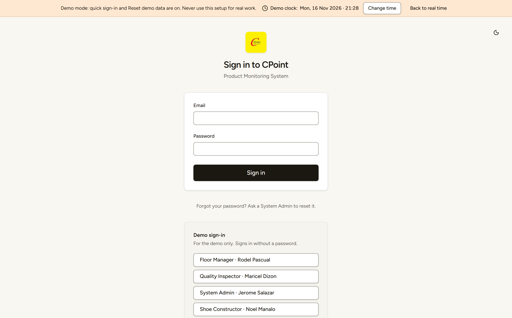

**If you type the wrong password 5 times**, the account is locked for 15 minutes. The message says
how many minutes are left. A System Admin can unlock it sooner.

### 3.3 Your first sign-in: choose your own password

A new account gets a **temporary password** from the System Admin. The first time you sign in, the
page **Choose your password** opens. Type a new password and save it. You can't use the system until
you do. Other devices signed in to your account are signed out.

### 3.4 Find your way around

- The **menu** on the left lists your pages. On a phone, it is at the top.
- Click **your name** at the bottom of the menu to **Change password** or **Sign out**.
- You stay signed in for up to 12 hours. Sign out when you leave a shared computer.

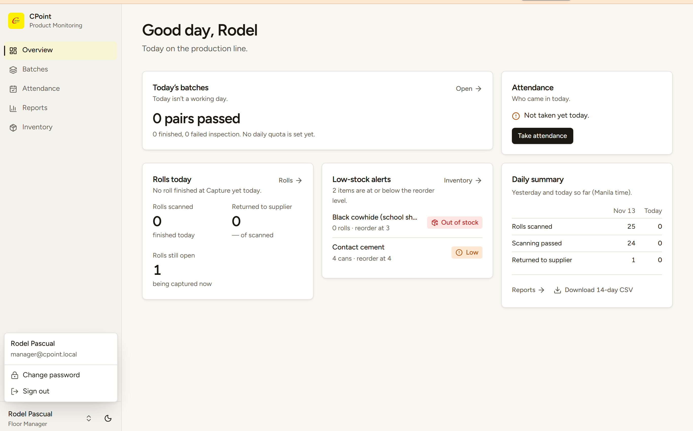

> **Demo mode.** During a demonstration, a **Demo mode** band shows at the top of every page, and the
> sign-in page has one **Demo sign-in** button per role. This is only for demos; it is never turned
> on for real use.

---

## 4. Shoe Constructor: scan a leather roll

Your only page is **Capture**. You use it on your phone to photograph each roll before it is cut.

### 4.1 Before you start

- **You need camera access.** If the page says "Ask the System Admin for camera access.", ask the
  System Admin to give it to you.
- **Have the marker card ready.** It is printed at 100% size and kept at the station. If it is
  missing, use **Print the marker card** on the Capture page.
- **Allow the camera.** The first time, your browser asks to use the camera. Tap **Allow**.
- **Check the plan.** The card at the top shows how many rolls were scanned today against the
  Floor Manager's plan, for example "Plan reached" when the target is met.

### 4.2 Start a roll

1. Under **Choose the leather of this roll**, pick the leather type.
2. Under **Roll on the table**, pick the roll. Match the code on the roll's label. Or tap **Scan the
   roll's label** and point the camera at the sticker: the roll is picked for you.
3. Tap **Start scanning**.

When a roll is picked, it leaves its rack or bin in the system. Put the roll on the table.

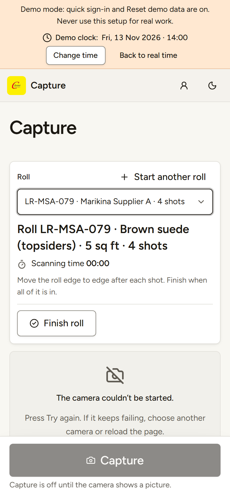

If the list says "No rolls are waiting to be scanned", ask the Floor Manager to add the rolls in
Inventory.

### 4.3 Take the shots

1. **First shot:** lay the marker card flat on the leather, fully inside the picture. The app says
   "Marker card found. This shot will be measured (N in across)." Capture stays off until the card is
   found in the first shot.
2. Tap **Capture** (on a computer you can also press **Space**).
3. Read the result under **Last scan**:
   - **Pass** (green): this part of the roll can go on to cutting.
   - **Reject** (red): this part of the roll is not for cutting. Set it aside.
   - Each defect is marked on the photo, with its type and length.
4. Move the roll so the next part is under the camera, edge to edge, and capture again.
5. Repeat until the whole roll has been photographed. You don't need the card again for this roll.

A **Scanning time** timer runs while the roll is open. It pauses during the lunch break.

If a photo didn't reach the server (for example the Wi-Fi dropped), tap **Send again**, or
**Discard this capture** and take it again.

### 4.4 Finish the roll

1. When all of the roll is in, tap **Finish roll**.
2. The roll is taken off stock, and the app shows its **Defect %** against the limit:
   - **Within the limit**: the roll is **Scanning passed**.
   - **Over the limit**: the roll is **Returned to supplier**. The page asks **Where did you put it?**:
     choose the place where you set it aside, then tap **Set aside**, so the Floor Manager can find
     it when the supplier comes. (**Skip** leaves it for the Floor Manager to place.)
3. Tap **Start another roll** for the next one.

### 4.4a My stage: count the pieces or pairs at your stage

If the Floor Manager assigned you to a stage today (Preparation, Construction, Sole-ing or
Finishing), **My stage** is at the top of **Capture**, with or without camera access.

1. Type the count at your stage right now in **Pairs at … now** (**Pieces at Preparation now** at
   Preparation: the leather pieces cut from the rolls that passed the camera, not shoes yet) and tap
   **Save count**. The number is for the whole stage ("Last counted 14:05 for all of Sole-ing"), not for you. The last count
   stands until someone counts again.
2. When a batch has just ended the page says so ("B-261120-2 just ended. Update the count.").
3. **Repairs at your stage** lists pairs sent back to you, with the defect and a code such as
   RP-261120-2-1. When the repair is done, tap **Back for inspection**. The Quality Inspector then
   checks it.

If you have **Capture access**, your stage is always **Preparation**, every working day, because capture happens there. The page says so ("You have Capture access, so you work at Preparation.") and you count Preparation like any stage. The Floor Manager can't move you to another stage; to change it the System Admin first removes your Capture access.

If you see "You aren't assigned to a stage today. Ask the Floor Manager.", you can't count today.

### 4.5 Picked the wrong roll?

If you haven't taken a shot yet, you can undo it:

- **Put roll back**: the roll goes back to the list of rolls waiting to be scanned. The page asks
  **Where did you put it?**, with the place it was taken from already chosen; choose another place,
  or **Not placed**.
- **Cancel roll**: use this if the roll was started by mistake.

Once a roll has shots, it can only be finished.

### 4.6 Floor view (station monitor)

At a fixed station with a monitor, tap **Floor view** (next to Capture). The camera fills the
screen. After each capture a big coloured band shows the result:

| Result | Colour | Where the part goes |
| ------ | ------ | ------------------- |
| Pass   | Green  | On to cutting       |
| Reject | Red    | Set aside, not cut  |

Press **Space** to capture. Press **Esc** to leave Floor view. The browser remembers Floor view, so
the station opens straight into it next time (press F11 for full screen).

### 4.7 Find roll: where is that roll?

If the System Admin gave you camera access, **Find roll** is in your menu next to **Capture**. It works
on a phone.

1. Type the roll's code (for example `LR-MLT-004`, or part of it) or the supplier's tag number in
   **Roll code or tag number**, then tap **Find**. Or tap **Scan label** and point the camera at the QR
   code on the roll or on a rack.
2. The roll's page shows **Where it is** in large text (for example "R1-B3 · Rack 1, bin 3"), its
   leather, supplier, area and status, and its **Location history**: each move with its time and
   a note. The history never names a person.
3. A rack's label shows the rolls kept there. Tap a roll to open it. If several rolls match, pick one
   from the list.

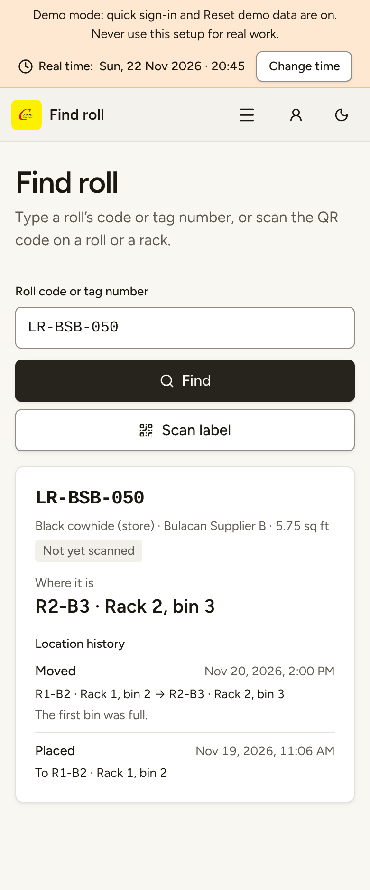

You can only look rolls up. The Floor Manager places and moves rolls. If the page says "No roll or
location has the code … Check the label or type the code.", check the sticker or type the code again.

---

## 5. Quality Inspector: finish each batch

Your only page is **Batches**. You can use it on a phone.

Every batch has its own code, for example **B-261116-2**: the second batch of 16 Nov 2026
(B, then the year, month and day, then the batch number that day).

### 5.1 The Inspection queue (your home)

Batches opens on the **Queue** tab. It lists every batch that has ended and still waits for
inspection, **from any day**, with the most urgent first and then the one that has waited longest.

Each batch shows its code, its day and times, the leather rolls scanned during it, how long it has
waited, and a badge: **Waiting**, **Late** (more than 30 minutes after it ended), **Urgent** (the
Floor Manager's reason is shown), or **Being inspected** (by whom).

1. Tap **Start inspection** on the batch you are counting. Others then see that you have it.
2. Tap **Inspect**, enter the **Pairs finished** and how many **failed inspection**, then tap
   **Finish B-…**. The batch leaves the queue.

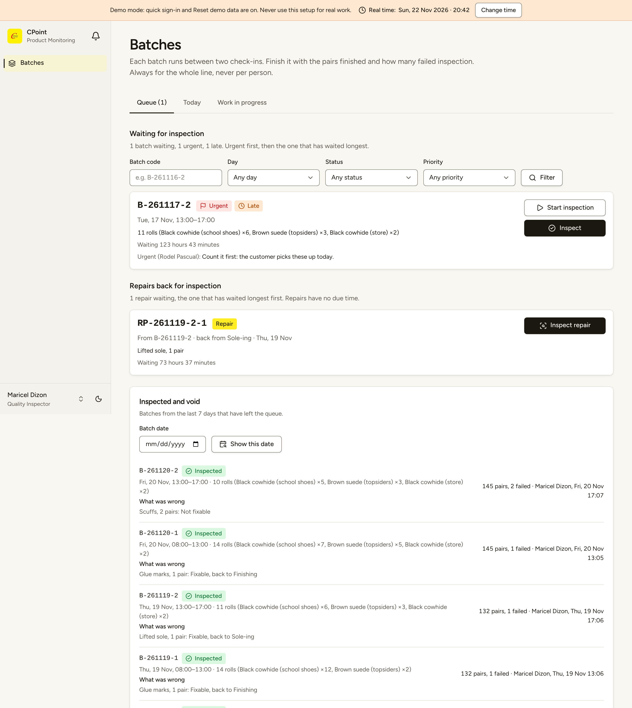

A batch no longer closes at midnight: yesterday's batch stays in the queue until you inspect it.
Use **Batch code**, **Day**, **Status** and **Priority** at the top to find one, then **Filter**.
**Inspected and void** at the bottom lists the batches of the last 7 days that have left the queue.

### 5.2 Read the Today tab

- **Today against the quota**: today's passed pairs against the day's quota.
- **The list of today's batches**: each batch with its start and end time. The lunch break is left
  out of the batch it falls in.
- **Recent days** (the Floor Manager only): earlier days, with a short reason for any day that
  fell short.

If there are no batches, the page tells you why, for example "No batches yet today. The Floor
Manager plans them first." Saturdays, Sundays and days marked Non-working / Holiday have no batches.

### 5.3 Watch for the notices

- **10 minutes before a batch ends**, a banner says, for example, "B-261116-2 ends at 17:00. Get
  ready to count the finished pairs."
- **When the batch ends**, it says "B-261116-2 is due. Finish it now." The bell shows it, and the
  browser tab shows "(1)".

Keep the Batches page open on your phone so you see the notices.

### 5.4 Finish a batch from the Today tab

1. Tap **Finish batch** on the batch that is due.
2. Enter the **Pairs finished** in that batch.
3. Enter how many of these **failed inspection**.
4. Tap **Finish B-…**. The page says, for example, "B-261116-2 finished."

The form also shows how many Shoe Constructors are present today. If it says "Attendance not taken
yet", remind the Floor Manager; you can still finish the batch.

A batch can only be finished once.

### 5.4a Say what was wrong with the failed pairs

When **Of these, failed inspection** is more than 0, **What was wrong** appears. Add one line for
each defect:

1. Choose the **Defect** and type the **Pairs**.
2. Choose **Fixable** or **Not fixable**. For a fixable one choose the stage it **Goes back to**:
   Construction, Sole-ing or Finishing. Preparation is not offered, because the camera already
   checked the leather and no shoe is there to repair.
3. **Add another defect** for the next line. If the form suggests an answer ("Usually fixable at
   Sole-ing, 14 of 17") tap **Use this**, or ignore it. It is never filled in for you.
4. The lines must add up to the failed pairs. The form tells you what is missing ("3 of 5 failed
   pairs have a reason") or too many ("You listed 6 for 5 failed pairs. Remove 1."). **Other** needs
   a description.

Each fixable line becomes a **repair** with a code such as **RP-261120-2-1** at its stage. A not
fixable line is scrapped.

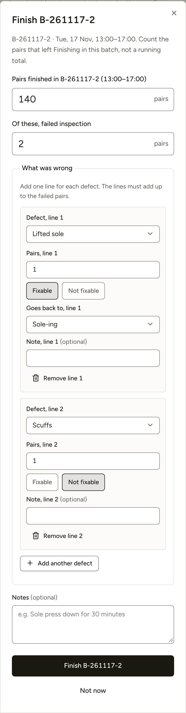

### 5.4b Inspect a repair

When the stage marks a repair **Back for inspection**, it joins the **Queue** under
**Repairs back for inspection**, with the batch it came from, the defect and how long it has waited.
Repairs have no due time. Tap **Inspect repair** and enter how many pairs **Passed**, were
**Scrapped**, or are **Sent back again** (**Send some back again**, then Construction, Sole-ing or Finishing). The three must
add up to the repair's pairs. A repair can fail again as often as needed. Passed repaired pairs count
toward the quota on the day they pass.

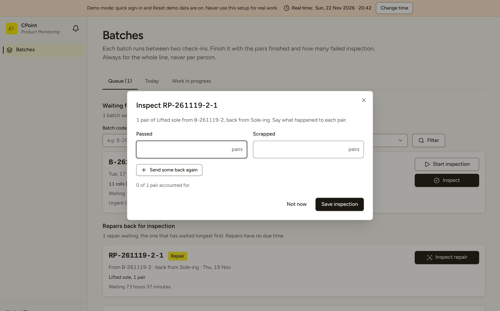

### 5.5 Correct a mistake

On the day you inspected the batch, tap **Correct** on the finished batch, change the numbers, and write **Why are you
correcting it?** Then tap **Save correction**. Both the old and new counts are kept in the audit log.
The failed pairs and the lines under **What was wrong** can change only while none of the batch's
repairs is back for inspection; after that the dialog says so and you can still correct the other
counts.

---

## 6. Floor Manager: plan, track and report

Your pages are **Overview**, **Batches**, **Attendance**, **Reports** and **Inventory**.

### 6.1 Overview (your home page)

A summary of today on the line, in three groups:

- **Needs attention** (only when something is due, otherwise it is not shown): **Plan today** when a
  weekday has no plan yet, and **Stock update today** on your reminder days (Wednesday and Friday
  unless you change them) until an update is saved. Each has one button; when both show, **Plan today**
  is the filled one. The "Today has no plan yet" banner doesn’t show on this page (the row says it);
  it still shows on your other pages.
- **On the line now**: **Today’s batches** (passed pairs against the quota, and the next batch due) beside
  **Work in progress** (pieces at Preparation and pairs at each stage after it, the repairs open and what waits for inspection).
- **Today so far**: **Attendance** (says "Not taken yet today." until you save it; tap **Take
  attendance**), **Rolls today** (rolls scanned, returned to supplier and still open), **Low-stock
  alerts** (items at or below their reorder level) and **Daily summary** (yesterday and today so far,
  with **Download 14-day CSV**).

### 6.2 Plan the days (Batches → Plan days)

A day without a plan has no batches, so plan each working day.

1. Go to **Batches** and tap **Plan days**. A month calendar opens.
2. Click a weekday (today or later).
3. Fill in:
   - **Rolls to be used**: an estimate. Shoe Constructors may start more.
   - **Quota (pairs that pass)**. **Use suggestion** fills in a suggested number.
   - **Check-in interval**: **Every 4 hours** or **Once at the end of the day**.
   - **Shift start** and **Shift end**.
4. Check the batches shown under **Batches:**, then tap **Save plan**. The page says "Plan saved for …".

To close a weekday, choose **Mark Non-working / Holiday**. That day has no batches, no plan notice and
no stock reminder.

Good to know:

- Saturdays, Sundays and past days can't be planned.
- You can plan up to three months ahead.
- Today's plan can change until its first batch is finished.
- Past days show what happened, for example "2 of 3 rolls scanned · 1 returned".
- The lunch break is set by the System Admin.

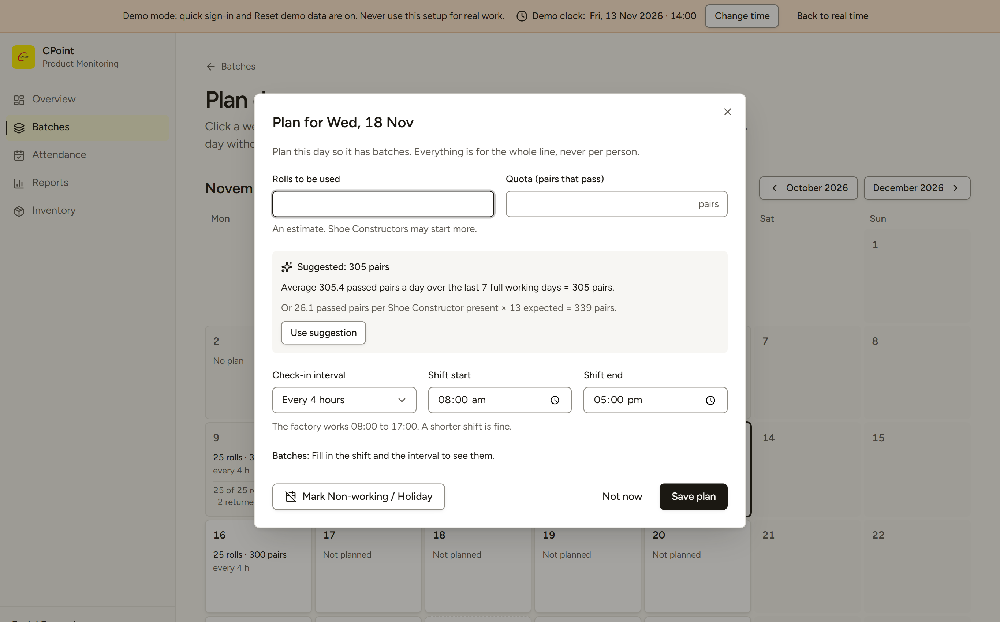

### 6.3 Batches

You see the same Batches page as the Quality Inspector (see [section 5](#5-quality-inspector-finish-each-batch)).
**If no Quality Inspector is present today**, you can finish the batches yourself. They are saved
under your name and marked in the audit log as covering.

The **Queue** tab shows every batch waiting for inspection (see [section 5.1](#51-the-inspection-queue-your-home)).
There you can:

- **Mark Urgent** a waiting batch, with a reason such as "Customer pick-up at 3 pm". It moves to
  the top of the queue. **Set to Normal** puts it back.
- **Void** a batch that won't be inspected, with a reason such as "Line stopped, no pairs made".
  It leaves the queue. This can't be undone.

Once a batch is being inspected, Urgent, voided or finished, today's plan can't change it.

**Correct a past record** (only you can; the Quality Inspector corrects only on the day they inspected a
batch). Every correction asks **Why are you correcting it?** and keeps the old and the new value in the
audit log.

- **A batch from any past day:** on the **Queue** tab, under **Inspected and void**, choose the
  **Batch date** and **Show this date** (**Last 7 days** goes back). Tap **Correct** on the batch. You
  can also reach a day from **Reports → Operations**: **See batches** under the day, which is marked
  **Corrected** once a batch of it was changed on a later day. The failed pairs and the lines under
  **What was wrong** can't change once a repair from the batch is back for inspection.
- **A repair's inspection:** in the same list, tap **Correct** on the inspected repair and change how
  its pairs split between **Passed**, **Scrapped** and **Sent back again** (the total stays the same).
  You can do this while the pairs it sent back are still at their stage; once one is back for inspection,
  inspected or marked not fixable, the row says so and it can't change.
- **A roll's details:** open the roll (**Reports → Rolls**) and tap **Edit details** to correct its
  tag number, the day it was received and, for a roll that was returned or kept before the new rule,
  its return note. Its **area** can change only until a Shoe Constructor taps **Finish roll**: the defect
  share and the return mark were worked out from it. The supplier and the leather item don't change;
  use **Move** for its place.

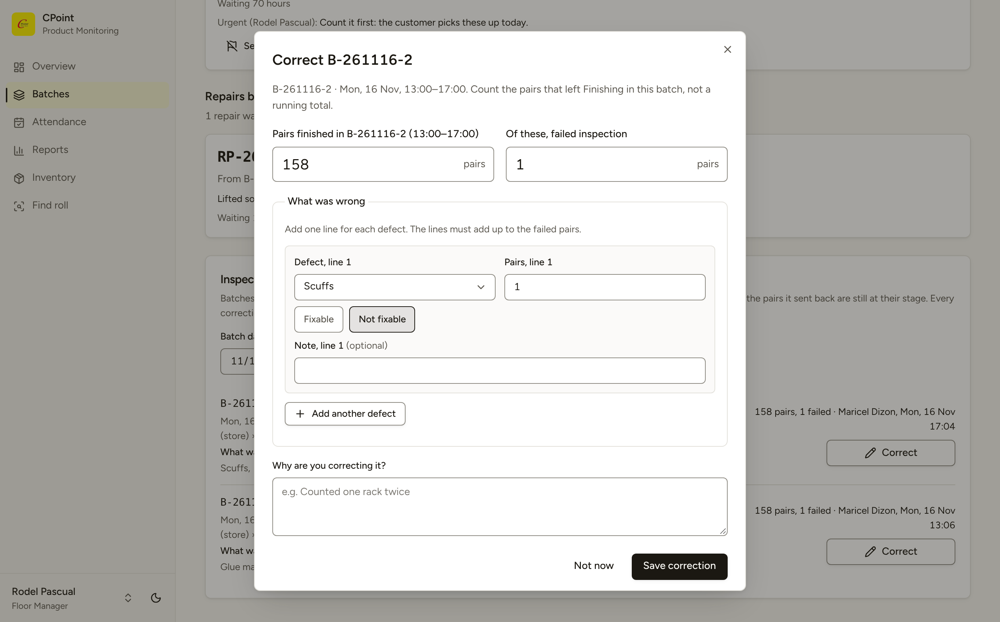

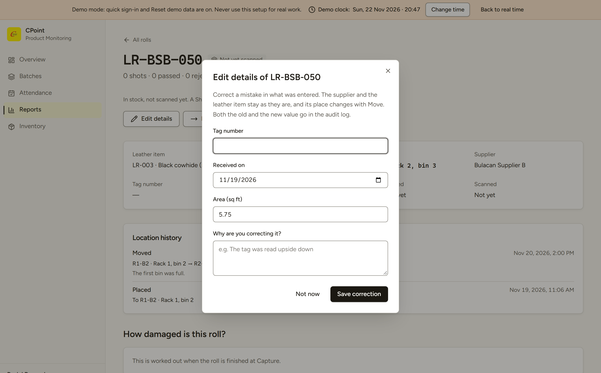

**Recent days** explains each short day in one sentence, for example "Below quota by 18 pairs. 3 of
12 Shoe Constructors were absent." It never names a person.

### 6.3a Stages and work in progress

- **Who works where:** in **Batches → Plan days**, open a planned day. **Who works where** lists the
  active Shoe Constructors under each stage. A constructor with **Capture access** is already under **Preparation**, ticked and locked ("Has Capture access"), and isn't offered under the other stages: they are at Preparation every working day, and nothing is saved for them. Everyone else can go to any stage, Preparation included. Tick a person at one stage (each is at one stage a
  day; ticking them elsewhere moves them), then **Save stages**. A day with none starts from the
  last working day ("Same as Thu 19 Nov. Save to confirm."); nothing is saved until you do. You can
  change today and later planned days even after the plan locks; past days are read-only. A person
  marked absent that day is flagged **Absent**.
- **Work in progress:** the third tab on **Batches**. Each stage shows its count now ("14 pairs as of
  14:05", "33 pieces as of 14:05" at Preparation, or "Not counted today"; Preparation counts leather pieces because nothing is a shoe until Construction), its repairs and a quiet line "Assigned today: …" below. Use
  **Update count** for a stage nobody is assigned to. On a repair at a stage use **Back for
  inspection** (or **Change**: move it to another stage, or **Not fixable after all**, each with a
  reason, until it is back). The Overview has a small card for it.

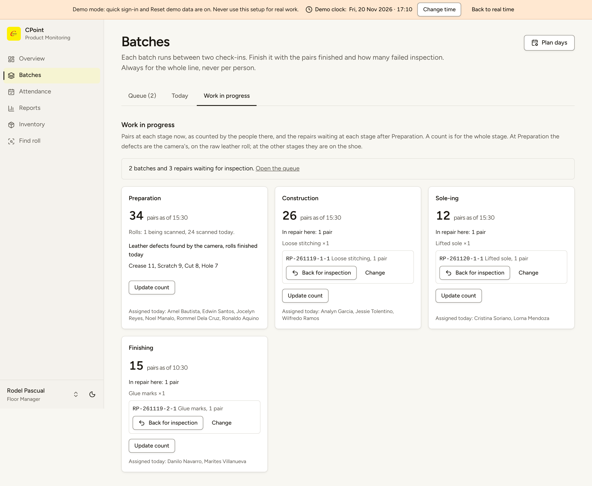

- **Preparation has no repairs, and shows the camera's defects.** There the camera inspects the raw
  leather roll. The **Preparation** card lists **Leather defects found by the camera, rolls finished
  today** ("Scratch 9, Crease 7": rolls per defect type, the same count as **Reports → Rolls**, the
  types from Settings) and, when a roll went back, "Returned to supplier: 1 roll."; with none it says
  "The camera found no defects on today's rolls." Those defects decide a roll's Pass or Return to
  supplier, never a repair. No repair goes back to Preparation: a repair goes only to Construction,
  Sole-ing or Finishing, where a finished shoe is inspected and its final defects (Lifted sole, Glue
  marks, Loose stitching, Scuffs, Other) are recorded.
- On the demo data the board is already live (Phase 37): one repair At stage at Construction, Sole-ing and
  Finishing, three repairs Back for inspection in the Queue, and Finishing's count older than the others
  ("as of 10:30" beside "as of 15:30") so there is a card to update, as in the screenshot above.

- **Reports → Operations** has four new sections: **Final defects**, **Where defects come from**,
  **Repairs** and **Work in progress**. Failed pairs from before reasons were recorded show as
  "Reason not recorded". Nothing is by person. **Work in progress** there compares only the stages
  counted in pairs (Construction, Sole-ing and Finishing: days counted, average, highest, latest and
  a bar for the stage where pairs wait most). **Preparation** is counted in pieces, so it is left
  out of the report and stays on the board, the Overview card and **My stage** (Phase 40, D-137).

### 6.4 Attendance

1. Go to **Attendance**. Today's list opens.
2. Tap **Mark everyone present**, then untick anyone who is absent. Or tick people one by one.
3. Tap **Save attendance**. The summary reads, for example, "12 of 13 Shoe Constructors present".

Use **Previous day** and **Next day** to fix an earlier day, and **Back to today** to return. Only
Shoe Constructors count toward the line's worker count. Attendance is a one-day log book: there is
no history or count per person.

### 6.5 Inventory

The Inventory page lists every material: leather rolls, nails, adhesive, thread, equipment and
others. Use the filters to find an item or to see only **Low or out** of stock.

**Add a new item**

1. Tap **Add item**.
2. Fill in the name, category, code (keep the suggested one or use the code from the log book) and
   **Reorder at** (the item is flagged as low at or below this number).
3. For a leather roll item, also **Choose a supplier**. It starts at 0 rolls.
   For other items, enter the **Opening stock** (what's on the shelf today).
4. Tap **Add item**.

**Add leather rolls when a delivery arrives**

1. Open the leather item and tap **Add rolls**.
2. Enter **Arrived on** (the delivery date).
3. Choose **Kept in** (optional): where the rolls are stored. The place you used last time is
   chosen for you.
4. Enter each roll's area in **sq ft**, and the **Supplier's tag** if the supplier gave one. Tap
   **Add another roll** for each extra roll.
5. Tap **Save** (for example **Save 3 rolls**). Each roll gets its code when you save. The message
   offers **Print its label** (or **Print their labels**).

The leather item's count follows its rolls. A roll leaves stock when a Shoe Constructor finishes it at
Capture, or when you remove it.

**Remove a damaged roll** (for example water damage): open the roll and choose **Remove roll…**. It
leaves stock and can't be scanned. Any shots it already has stay on record.

**Storage locations**

Under **Inventory**, tap **Storage locations** to set up where rolls are kept. CPoint chooses its own
codes; the demo uses placeholders such as `R1-B3` and `RETURN`.

1. Tap **Add location**. Enter the **Code** (2 to 20 letters, numbers or dashes, like R1-B3), an
   optional **Name** ("Rack 1, bin 3") and **Notes**, and choose whether it is a **Rack**, a **Bin** or
   an **Area**. Save.
2. The table shows each location's **Rolls in it** and its **Status**. Use the pencil to **Edit** one.
   A location's **code** can't change once rolls were kept there (it is printed on labels); its name
   can. A location with rolls in it can't be deactivated: move the rolls first.
3. Tick locations and tap **Print labels** (for example **Print 2 labels**) to print their stickers.

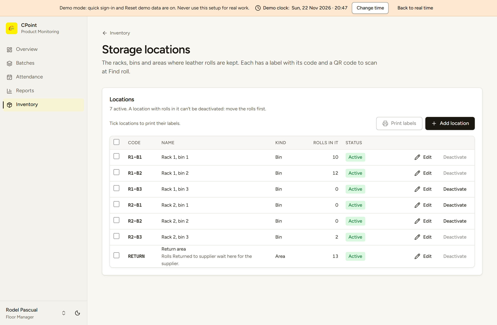

**Print roll labels**

1. On a leather item, tap **Print labels** for every roll not scanned yet, or use **Print its label**
   right after **Add rolls**.
2. The page shows an A4 sheet of 3 × 7 stickers: the roll's code in large letters, a QR code, the
   leather, supplier, area and tag. Tap **Print** and print at **actual size (100%)** on sticker paper.
3. Stick each label on its roll. A location's sticker goes on its rack or bin.

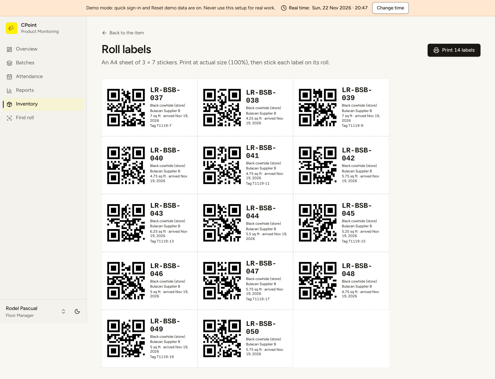

**Place or move rolls**

1. On the leather item, tap **Move rolls**. Tick the rolls, choose **Move to** (a location), add a **Note**
   if useful ("Rack 1 was full"), then tap **Move 3 rolls** (the number you ticked).
2. For one roll, open it (**Reports → Rolls**) or use **Inventory → Find roll**: **Move**, or **Place it** for a roll
   with no place yet. Every move is added to the roll's **Location history**; nothing is erased.
3. When a Shoe Constructor picks a roll at **Capture**, it leaves its place automatically. A roll put
   back is placed again.

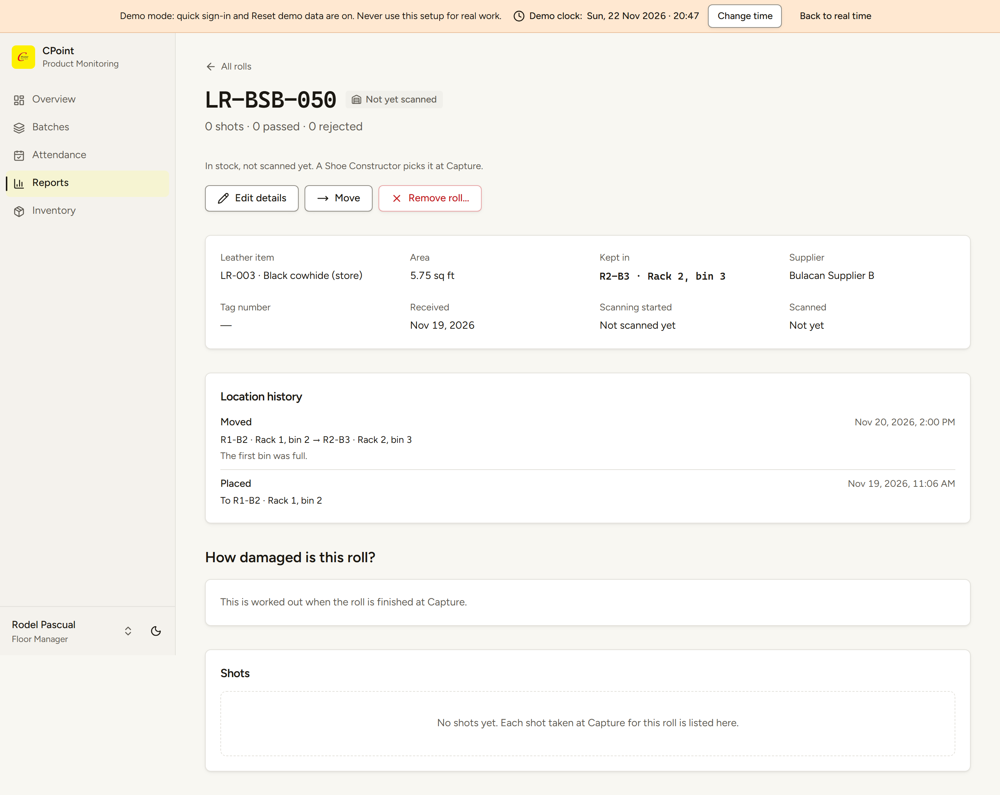

**A roll Returned to supplier**

The constructor sets it aside in a place after **Finish roll** (the demo uses `RETURN`). It stays there
until the supplier collects it. Then open the roll (or find it with **Inventory → Find roll**) and tap **Picked up by
supplier**. The place is free again. If nobody set it aside, tap **Set aside** and choose a place.

**Update stock for other materials**

1. Tap **Update stock**. One sheet lists every item.
2. For each item that changed, type what was **Added (+)** and **Used (−)** since the last update.
3. If the shelf doesn't match, enter a **Correction** with a **Reason**. A correction isn't counted
   as use.
4. Leave items blank if nothing changed.
5. Tap **Save update**.

Under **Reminder days** you can choose the days the stock update reminder shows (**Remind me on**).

Mistakes are never edited away. Fix them with a Correction; every change stays in **Stock history**.

### 6.5a Find roll

Open **Inventory** and tap **Find roll** at the top of the page (on a phone-sized window it is the first
button). Find roll is not in your menu; **Inventory** stays marked while you are on it, and **Inventory**
at the top left of the page takes you back. It works like the constructors' version (see
[section 4.7](#47-find-roll-where-is-that-roll)), and you can also **Move** a roll, **Place it**, or mark it
**Picked up by supplier** from the result. **Open the roll's page** goes to its report.

### 6.6 Reports

Open **Reports**. Reports never show figures per person.

**Choose the period.** Operations, Quality and Rolls have the same picker at the top:

- **Day**: pick the date in the **Day** box.
- **Week**: pick the **Year**, **Month** and **Week** of the month (week 1 starts on the first of the month,
  as on Materials).
- **Month**: pick the **Year** and **Month**. The figures are compared with the month before.
- **Custom**: type **From** and **To** (up to 366 days) and tap **Show**.
- Beside the tabs, the quick links **Today**, **7 days**, **14 days** and **30 days** set a range at once.
- On **Rolls**, **Any time** (the default) shows every roll; choose a period to filter by the day the
  roll was added.

A future date can't be chosen. The page address holds the period, so a link, a CSV and a printout all show the same dates.

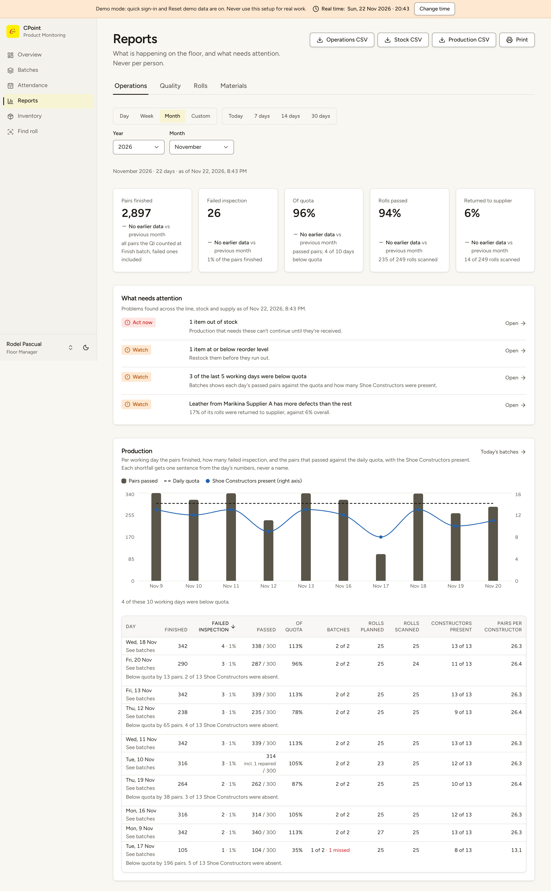

**Sort a table.** Click a column header: the arrow shows the direction; click again to reverse. The
Rolls table, Supplier quality and the other tables sort this way. The CSV ignores the sort.

**Filter.** **Operations** has **Defect filters** (a defect type, **Fixable or not**, a stage) for its defect
cards and a **Supplier filter** on Supplier quality; **Quality** filters by defect; **Rolls** by leather item
and location. **Clear** removes a filter. A card that is filtered says "Filtered:" and what the filter is.

**Print.** Tap **Print** on a report. The printout has the report's name and period, **Printed** and **Prepared
by** (your name), the filters and sort in words, and tables that repeat their heading on every page. At
the bottom, **Remarks** and two signature lines (**Prepared by**, **Checked by**). Type the remarks first if you
want them printed; they are **not saved** and the paper is the record. Charts do not print. **Rolls**
prints every matching roll, up to 500. In the print window choose **Save as PDF** to keep a file.

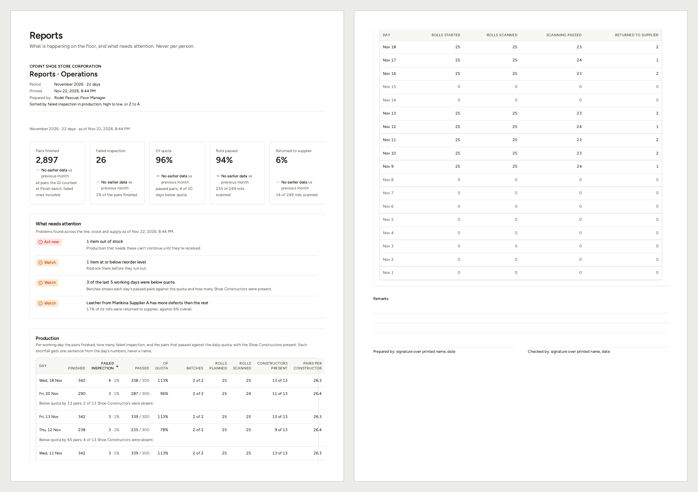

| Report         | What it shows                                                                                                                                                                              |
| -------------- | ------------------------------------------------------------------------------------------------------------------------------------------------------------------------------------------ |
| **Operations** | What needs attention, today's batches, pairs finished, failed inspection and share of the quota, the checkpoint before cutting, materials at risk, supplier quality and the daily summary. |
| **Quality**    | Rolls scanned per day (passed or returned) and defects by type, biggest first.                                                                                                             |
| **Rolls**      | Every leather roll with its supplier, area, shots, Defect %, scanning time and status.                                                                                                     |
| **Materials**  | Each material's use per week of the month, days left, and the leather rolls used and returned.                                                                                             |

**Supplier quality** lists suppliers, worst first. A supplier is marked **High** when it has at
least 5 rolls and its share of returned rolls is at least 10 points above the whole line's.

**Download for Excel:** tap any **CSV** button (for example **Operations CSV**, **Rolls CSV** or
**Materials CSV**) and open the file in Excel. The file follows the period and filters you chose.

### 6.7 Send a bad roll back: the claim sheet

1. Go to **Reports → Rolls** and open a roll marked **Returned to supplier**.
2. The roll page shows each shot with its photo, verdict and defects, and why it was returned, for
   example "defects cover 14% of this roll, over the 10% limit."
3. Tap **Claim sheet**. It lists the roll, its rejected sections and their photos.
4. Tap **Save as PDF** and send it to the supplier.

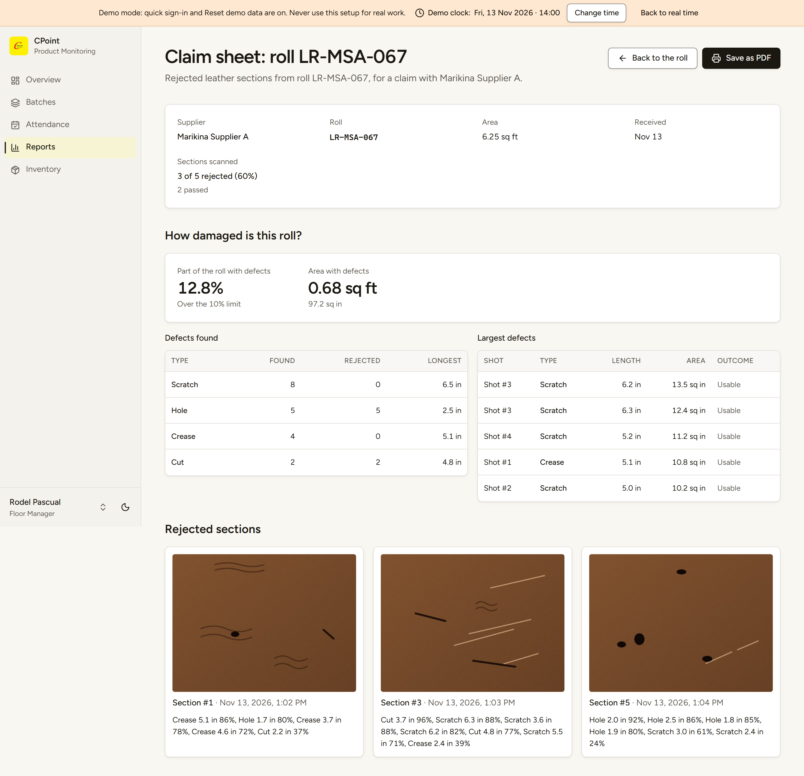

---

## 7. System Admin: users and settings

Your pages are **Overview**, **Users**, **Settings** and **Audit log**.

### 7.1 Overview

System health, active accounts by role, the lunch break and recent audit entries, on one page.

### 7.2 Users

**Add a person**

1. Tap **Add user**.
2. Enter the **Name**, **Email** and **Role**.
3. Save. The system shows a **temporary password** once. Copy it and give it to the person. They choose
   their own password the first time they sign in.

**Give a Shoe Constructor camera access**

Open **More actions** (the menu on the person's row) and choose **Give camera access**. Choose
**Remove camera access** to take it away.

**Other actions** (under **More actions**):

- **Reset password…**: signs the person out everywhere and gives you a new temporary password for
  them.
- **Unlock**: for an account locked after too many wrong passwords.
- **Deactivate…**: the person can no longer sign in. You can't deactivate yourself or the last active
  System Admin.
- **Edit** (the pencil): change the name, email or role. A role change applies the next time they
  open a page.

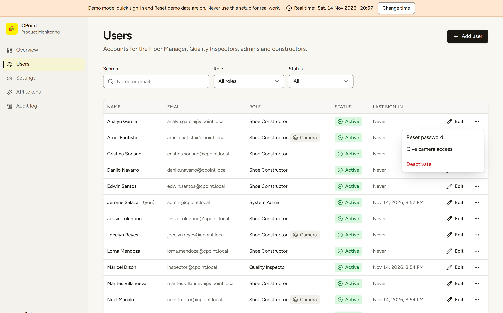

### 7.3 Settings

Settings has five tabs.

**Final defect types** (Phase 34): the defects the Quality Inspector picks for pairs that fail
inspection (Lifted sole, Glue marks, Loose stitching, Scuffs, Other). It is a separate list from the
camera's **Defect types**. Add, rename or switch types off; the key can't change. **Other** always
stays on. The five shown are examples until CPoint gives its own list.

**Thresholds**

- **A defect counts as found at** (50% by default): how sure the camera must be that a defect is
  there. Below this, a detection counts for nothing.
- **Mark a roll Returned to supplier when defects cover more than** (10% by default): checked when a
  roll is finished, against the roll's area.
- **Early model notice**: **Show "Early model" on Capture** tells Shoe Constructors that the model is
  still being trained, so some verdicts may be wrong.

Changes apply to new scans only. Scans already taken keep the rule they were decided with.

**Defect types**

Each type the camera can find (crease, cut, hole, scratch), with:

- **When found**: **Usable (Pass)** or **Not accepted (Reject)**, or a length limit such as "OK under
  3 in, rejected from 3 in".
- **Each one adds this to the roll's total (%)**: leave blank to use the defect's real size.

If the camera model is retrained with a new type, add it here with the **Class key** exactly as the
model sends it. A type that isn't listed is ignored.

**Lunch break**

Set **Lunch starts** and **Lunch ends**, or **No lunch break**. It must sit inside the shift, and it
applies from the date shown in the message. It pauses the batch it falls in, every working day.

**Suppliers**

Add the leather suppliers CPoint buys from, with a **Name**, **Code**, and optional **Contact person**,
**Phone** and **Notes**. The Floor Manager picks from this list when adding a leather item.

### 7.4 Audit log

Every change and every sign-in, newest first, with the values before and after. It is read-only.
Filter by action or record type, or paste a record id to see its full history.

---

## 8. Messages you may see and what to do

| Message                                                                | What to do                                                                    |
| ---------------------------------------------------------------------- | ----------------------------------------------------------------------------- |
| "Too many wrong passwords. This account is locked for N more minutes." | Wait, or ask a System Admin to **Unlock** your account.                       |
| "You don't have access to that page"                                   | That page belongs to another role. Use the pages in your menu.                |
| "Ask the System Admin for camera access."                              | The System Admin gives camera access under **Users → More actions**.          |
| "The camera only works on a secure address."                           | Open the `https://` address of the system, not an `http://` number address.   |
| "This browser isn't allowed to use the camera."                        | Tap the camera icon in the address bar, choose **Allow**, then **Try again**. |
| "Another app is using this camera."                                    | Close the other camera app or video call, then **Try again**.                 |
| "Show the marker card to capture."                                     | Lay the printed card flat on the leather, fully in the picture.               |
| "The camera model isn't installed on the server."                      | Tell the System Admin. The rest of the system still works.                    |
| "No rolls are waiting to be scanned."                                  | Ask the Floor Manager to add rolls in **Inventory → Add rolls**.              |
| "The server didn't answer. Check the Wi-Fi, then try again."           | Check the phone's Wi-Fi, then try again.                                      |
| "Today has no plan yet, so there are no batches."                      | The Floor Manager plans today on **Batches → Plan days**.                     |
| "Attendance not taken yet."                                            | The Floor Manager saves today's attendance.                                   |
| "… is already inspecting B-…. Pick another batch."                     | Someone else is counting that batch. Take another one from the queue.         |
| "B-… was voided: …. It can't be finished."                             | The Floor Manager voided it. Nothing to count.                                |
| "A batch can only be corrected on the day it was inspected."           | Ask the Floor Manager: they can correct a batch from any past day.            |
| "No roll or location has the code … Check the label or type the code." | Check the sticker, or type the code again on **Find roll**.                   |
| "Add a storage location first." (the Move button is off)               | The Floor Manager adds places under **Inventory → Storage locations**.        |
| "Move its rolls first." (a location can't be deactivated)              | Move the rolls to another place, then deactivate it.                          |

---

## 9. Quick reference cards

**Shoe Constructor**

1. Capture → choose the leather → choose the roll → **Start scanning**.
2. Marker card in the first shot → **Capture**.
3. Green Pass: cut it. Red Reject: set it aside.
4. Move the roll, capture again, until all of it is in.
5. **Finish roll**. Over the limit? Say **Where did you put it?** and **Set aside**.
6. Lost a roll? **Inventory → Find roll**: type or scan its code.

**Quality Inspector**

1. Keep **Batches** open: the **Queue** lists every batch waiting, by its code (B-261116-2).
2. Take the top one: **Start inspection**, then **Inspect**.
3. Enter pairs finished and how many failed. Save.
4. Mistake? **Correct**, on the day you inspected it, with a reason. An older batch is the Floor Manager's to correct.

**Floor Manager**

1. Plan each weekday on **Batches → Plan days**.
2. Every morning: **Attendance → Mark everyone present**, untick the absent, **Save attendance**.
3. When a delivery arrives: **Inventory → leather item → Add rolls** (choose **Kept in**), then **Print
   its label** and stick it on.
4. On reminder days: **Inventory → Update stock**.
5. Check **Reports**: pick the period, sort, filter, **Print**. Send returned rolls back with the
   **Claim sheet**, and tap **Picked up by supplier** when they collect them.
6. Urgent batch? **Batches → Queue → Mark Urgent**. Mistake in a past record? **Correct**, with a reason.

**System Admin**

1. New staff: **Users → Add user**, give them the temporary password.
2. Constructors who scan: **More actions → Give camera access**.
3. Rules for the camera: **Settings → Thresholds** and **Defect types**.
4. Check who changed what in the **Audit log**.
