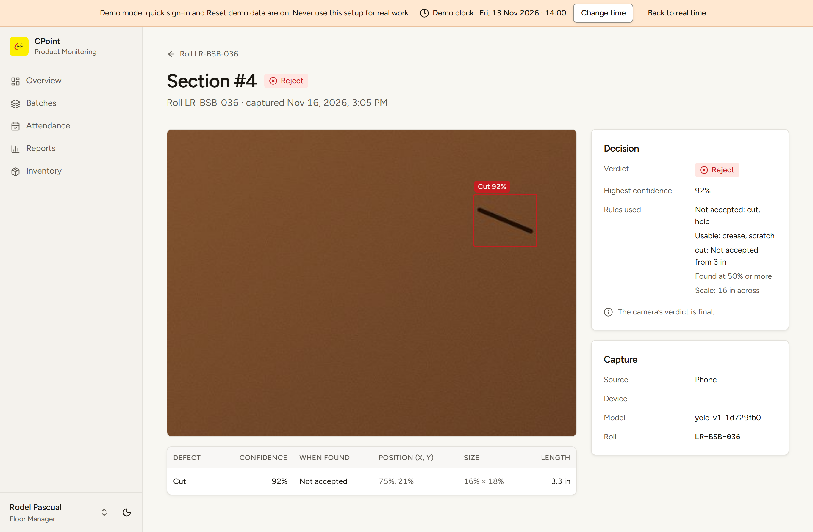
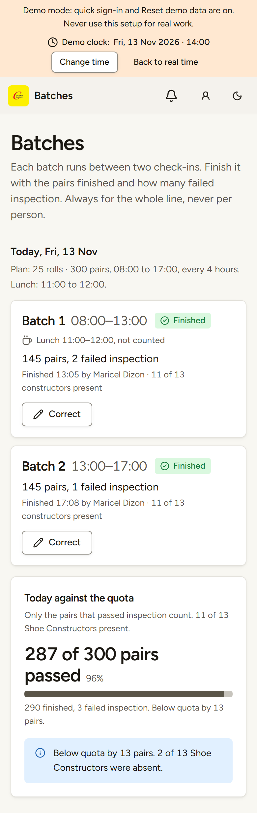
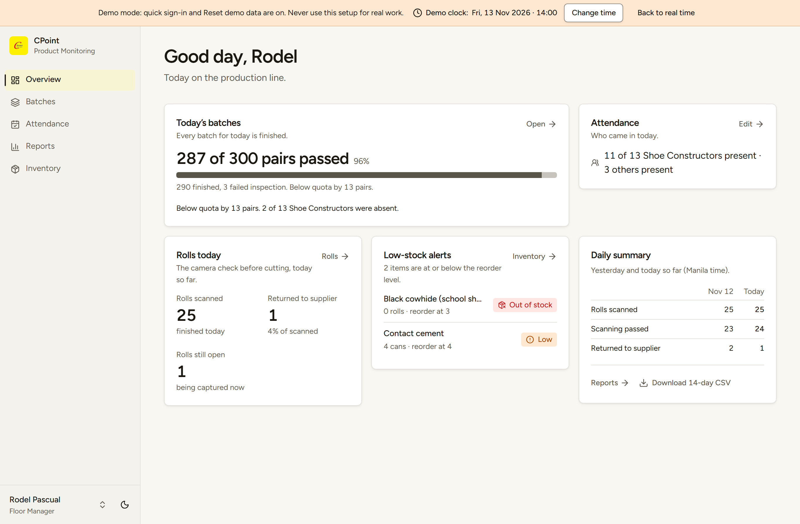
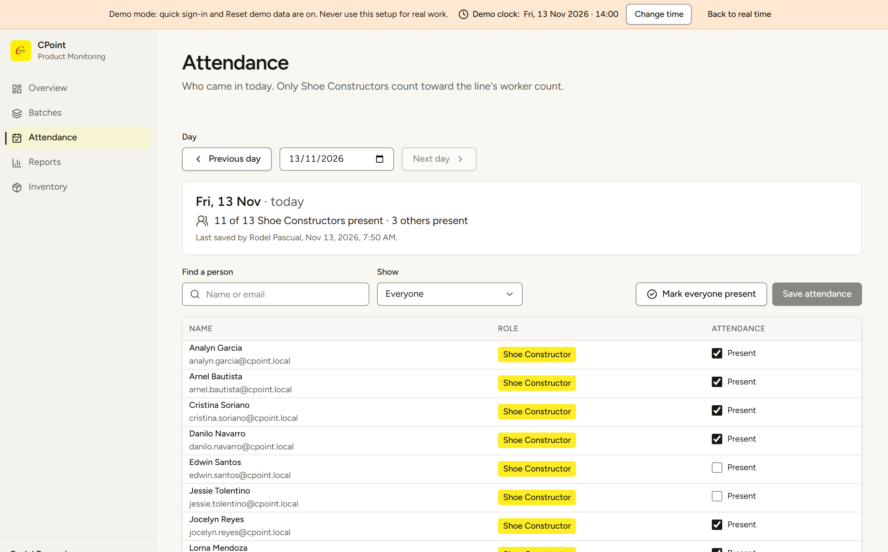
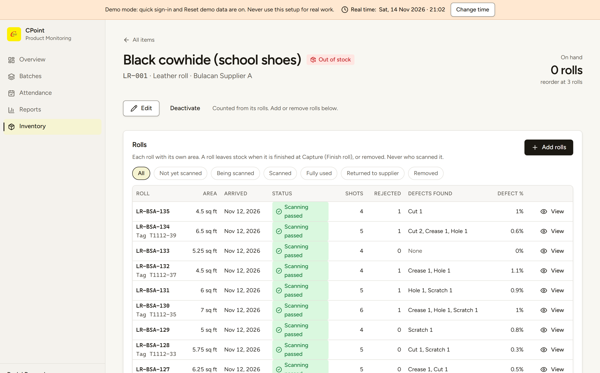
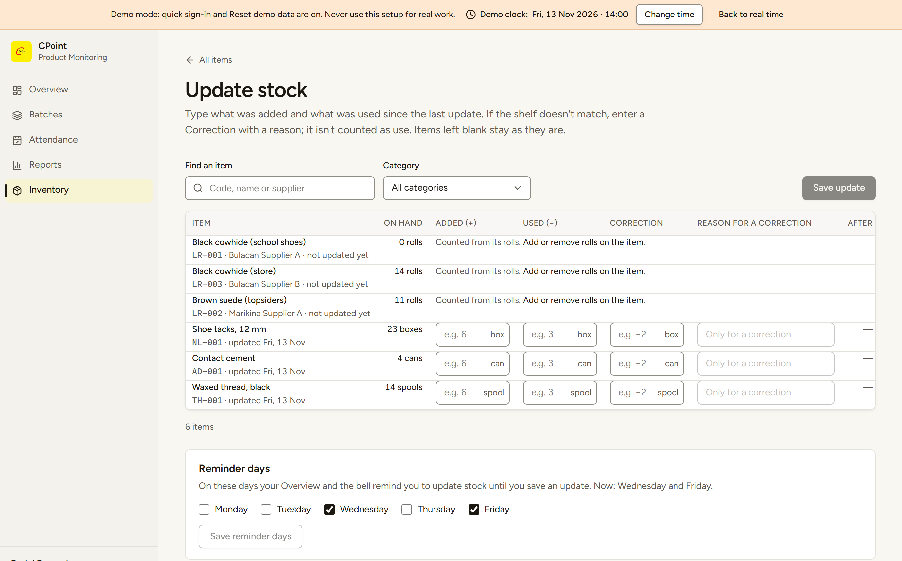
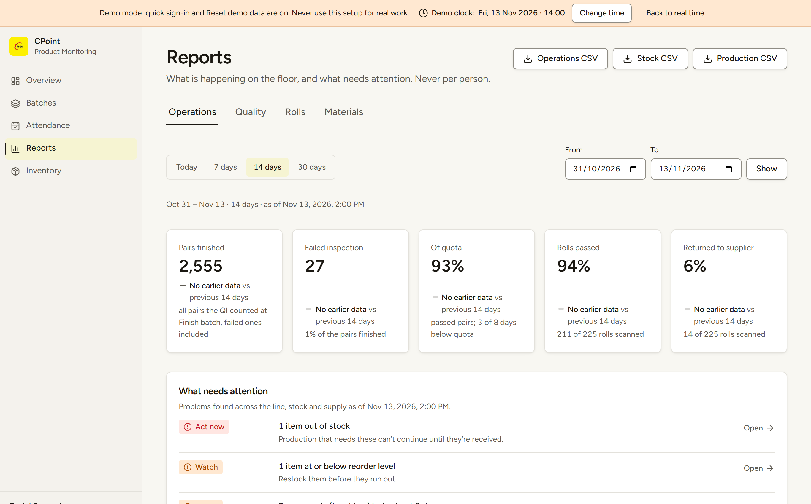
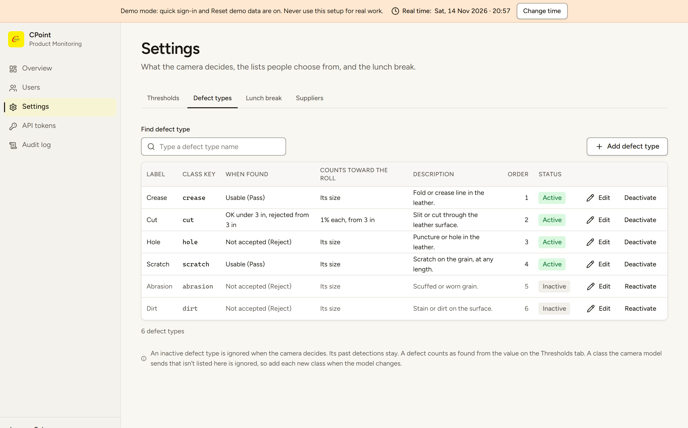

# CPoint Product Monitoring System: User Manual

For the people who use the system at CPoint Shoe Store Corporation: Shoe Constructors, Quality
Inspectors, the Floor Manager and the System Admin.

This manual explains how to do your daily tasks, step by step. You only need to read the part for
your own role. Words in **bold** are the exact buttons and labels you see on the screen.

---

## Contents

1. [What the system does](#1-what-the-system-does)
2. [Words to know](#2-words-to-know)
3. [Getting started (everyone)](#3-getting-started-everyone)
4. [Shoe Constructor: scan a leather roll](#4-shoe-constructor-scan-a-leather-roll)
5. [Quality Inspector: finish each batch](#5-quality-inspector-finish-each-batch)
6. [Floor Manager: plan, track and report](#6-floor-manager-plan-track-and-report)
7. [System Admin: users and settings](#7-system-admin-users-and-settings)
8. [Messages you may see and what to do](#8-messages-you-may-see-and-what-to-do)
9. [Quick reference cards](#9-quick-reference-cards)

---

## 1. What the system does

CPoint makes leather shoes in four stages: Preparation, Upper Making, Sole-ing and Finishing. The
system replaces the paper tally sheets with one shared screen.

- **Before cutting**, a Shoe Constructor photographs each leather roll with a phone. The app checks
  every photo for defects (holes, scratches, creases and cuts) and says **Pass** or **Reject**.
- **During the day**, the Quality Inspector records how many pairs were finished and how many
  failed inspection, once per batch.
- **The Floor Manager** plans each day, marks attendance, keeps stock up to date and reads the
  reports.
- **The System Admin** creates accounts and sets the rules the camera uses.

Every role sees only its own pages. Figures are always for the whole line, a roll, a day or a
supplier. **The system never ranks or scores individual workers.**

---

## 2. Words to know

| Word                      | What it means                                                                                                                                             |
| ------------------------- | --------------------------------------------------------------------------------------------------------------------------------------------------------- |
| **Roll**                  | One leather roll from a supplier. Each roll has its own code, such as `LR-BSA-001`, and its own area in square feet.                                      |
| **Shot**                  | One photo of part of a roll. A roll is scanned in several shots, edge to edge.                                                                            |
| **Pass**                  | This part of the roll can go on to cutting. Shown in green.                                                                                               |
| **Reject**                | This part of the roll is not for cutting. Set it aside. Shown in red.                                                                                     |
| **Usable / Not accepted** | Each defect the camera finds is either Usable (the shot can still pass) or Not accepted (the shot is rejected). A cut 3 inches or longer is Not accepted. |
| **Defect %**              | How much of the roll's area has defects. Worked out when the roll is finished.                                                                            |
| **Returned to supplier**  | A roll whose defects cover more than the limit (10% by default) of its area. It goes back to the supplier with a claim sheet.                             |
| **Scanning passed**       | A roll that was scanned and stayed within the limit.                                                                                                      |
| **Marker card**           | A printed card you lay on the leather in the first shot of each roll. It tells the app the real size in inches.                                           |
| **Batch**                 | One check-in period of the working day, for example 08:00 to 12:00. At the end of each batch the Quality Inspector counts the pairs.                      |
| **Quota**                 | The number of pairs that should pass inspection in a day.                                                                                                 |

The camera's verdict is **final**. Nobody changes Pass or Reject afterwards.

---

## 3. Getting started (everyone)

### 3.1 Open the system

Open the address your System Admin gives you in a web browser (Chrome, Edge or Safari). On the
computer that runs the system this is `http://localhost:3000`. On a phone, use the `https://`
address; the camera only works on a secure address.

### 3.2 Sign in

1. Type your **Email** and **Password**.
2. Click **Sign in**.
3. The system opens your home page:

| Your role         | Your first page                |
| ----------------- | ------------------------------ |
| Shoe Constructor  | **Capture**                    |
| Quality Inspector | **Batches**                    |
| Floor Manager     | **Overview**                   |
| System Admin      | **Overview** (System overview) |

**If you type the wrong password 5 times**, the account is locked for 15 minutes. The message says
how many minutes are left. A System Admin can unlock it sooner.

### 3.3 Your first sign-in: choose your own password

A new account gets a **temporary password** from the System Admin. The first time you sign in, the
page **Choose your password** opens. Type a new password and save it. You can't use the system until
you do. Other devices signed in to your account are signed out.

### 3.4 Find your way around

- The **menu** on the left lists your pages. On a phone, it is at the top.
- Click **your name** at the bottom of the menu to **Change password** or **Sign out**.
- You stay signed in for up to 12 hours. Sign out when you leave a shared computer.

> **Demo mode.** During a demonstration, a **Demo mode** band shows at the top of every page, and the
> sign-in page has one **Demo sign-in** button per role. This is only for demos; it is never turned
> on for real use.

---

## 4. Shoe Constructor: scan a leather roll

Your only page is **Capture**. You use it on your phone to photograph each roll before it is cut.

### 4.1 Before you start

- **You need camera access.** If the page says "Ask the System Admin for camera access.", ask the
  System Admin to give it to you.
- **Have the marker card ready.** It is printed at 100% size and kept at the station. If it is
  missing, use **Print the marker card** on the Capture page.
- **Allow the camera.** The first time, your browser asks to use the camera. Tap **Allow**.
- **Check the plan.** The card at the top shows how many rolls were scanned today against the
  Floor Manager's plan, for example "Plan reached" when the target is met.

### 4.2 Start a roll

1. Under **Choose the leather of this roll**, pick the leather type.
2. Under **Roll on the table**, pick the roll. Match the code on the roll's label.
3. Tap **Start scanning**.

If the list says "No rolls are waiting to be scanned", ask the Floor Manager to add the rolls in
Inventory.

### 4.3 Take the shots

1. **First shot:** lay the marker card flat on the leather, fully inside the picture. The app says
   "Marker card found. This shot will be measured (N in across)." Capture stays off until the card is
   found in the first shot.
2. Tap **Capture** (on a computer you can also press **Space**).
3. Read the result under **Last scan**:
   - **Pass** (green): this part of the roll can go on to cutting.
   - **Reject** (red): this part of the roll is not for cutting. Set it aside.
   - Each defect is marked on the photo, with its type and length.
4. Move the roll so the next part is under the camera, edge to edge, and capture again.
5. Repeat until the whole roll has been photographed. You don't need the card again for this roll.

A **Scanning time** timer runs while the roll is open. It pauses during the lunch break.

If a photo didn't reach the server (for example the Wi-Fi dropped), tap **Send again**, or
**Discard this capture** and take it again.

### 4.4 Finish the roll

1. When all of the roll is in, tap **Finish roll**.
2. The roll is taken off stock, and the app shows its **Defect %** against the limit:
   - **Within the limit**: the roll is **Scanning passed**.
   - **Over the limit**: the roll is **Returned to supplier**. Set it aside for the Floor Manager.
3. Tap **Start another roll** for the next one.

### 4.5 Picked the wrong roll?

If you haven't taken a shot yet, you can undo it:

- **Put roll back**: the roll goes back to the list of rolls waiting to be scanned.
- **Cancel roll**: use this if the roll was started by mistake.

Once a roll has shots, it can only be finished.

### 4.6 Floor view (station monitor)

At a fixed station with a monitor, tap **Floor view** (next to Capture). The camera fills the
screen. After each capture a big coloured band shows the result:

| Result | Colour | Where the part goes |
| ------ | ------ | ------------------- |
| Pass   | Green  | On to cutting       |
| Reject | Red    | Set aside, not cut  |

Press **Space** to capture. Press **Esc** to leave Floor view. The browser remembers Floor view, so
the station opens straight into it next time (press F11 for full screen).

---

## 5. Quality Inspector: finish each batch

Your only page is **Batches**. You can use it on a phone.

Every batch has its own code, for example **B-261116-2**: the second batch of 16 Nov 2026
(B, then the year, month and day, then the batch number that day).

### 5.1 The Inspection queue (your home)

Batches opens on the **Queue** tab. It lists every batch that has ended and still waits for
inspection, **from any day**, with the most urgent first and then the one that has waited longest.

Each batch shows its code, its day and times, the leather rolls scanned during it, how long it has
waited, and a badge: **Waiting**, **Late** (more than 30 minutes after it ended), **Urgent** (the
Floor Manager's reason is shown), or **Being inspected** (by whom).

1. Tap **Start inspection** on the batch you are counting. Others then see that you have it.
2. Tap **Inspect**, enter the **Pairs finished** and how many **failed inspection**, then tap
   **Finish B-…**. The batch leaves the queue.

A batch no longer closes at midnight: yesterday's batch stays in the queue until you inspect it.
Use **Batch code**, **Day**, **Status** and **Priority** at the top to find one, then **Filter**.
**Inspected and void** at the bottom lists the batches of the last 7 days that have left the queue.

### 5.2 Read the Today tab

- **Today against the quota**: today's passed pairs against the day's quota.
- **The list of today's batches**: each batch with its start and end time. The lunch break is left
  out of the batch it falls in.
- **Recent days** (the Floor Manager only): earlier days, with a short reason for any day that
  fell short.

If there are no batches, the page tells you why, for example "No batches yet today. The Floor
Manager plans them first." Saturdays, Sundays and days marked Non-working / Holiday have no batches.

### 5.3 Watch for the notices

- **10 minutes before a batch ends**, a banner says, for example, "B-261116-2 ends at 17:00. Get
  ready to count the finished pairs."
- **When the batch ends**, it says "B-261116-2 is due. Finish it now." The bell shows it, and the
  browser tab shows "(1)".

Keep the Batches page open on your phone so you see the notices.

### 5.4 Finish a batch from the Today tab

1. Tap **Finish batch** on the batch that is due.
2. Enter the **Pairs finished** in that batch.
3. Enter how many of these **failed inspection**.
4. Tap **Finish B-…**. The page says, for example, "B-261116-2 finished."

The form also shows how many Shoe Constructors are present today. If it says "Attendance not taken
yet", remind the Floor Manager; you can still finish the batch.

A batch can only be finished once.

### 5.5 Correct a mistake

On the day you inspected the batch, tap **Correct** on the finished batch, change the numbers, and write **Why are you
correcting it?** Then tap **Save correction**. Both the old and new counts are kept in the audit log.

---

## 6. Floor Manager: plan, track and report

Your pages are **Overview**, **Batches**, **Attendance**, **Reports** and **Inventory**.

### 6.1 Overview (your home page)

A summary of today on the line:

- **Today's batches**: passed pairs against the quota, and the next batch due.
- **Attendance**: says "Not taken yet today." until you save it. Tap **Take attendance**.
- **Rolls today**: rolls scanned, returned to supplier and still open.
- **Low-stock alerts**: items at or below their reorder level.
- **Stock update today**: shows on your reminder days (Wednesday and Friday unless you change them).
- **Daily summary**: yesterday and today so far, with **Download 14-day CSV**.

### 6.2 Plan the days (Batches → Plan days)

A day without a plan has no batches, so plan each working day.

1. Go to **Batches** and tap **Plan days**. A month calendar opens.
2. Click a weekday (today or later).
3. Fill in:
   - **Rolls to be used**: an estimate. Shoe Constructors may start more.
   - **Quota (pairs that pass)**. **Use suggestion** fills in a suggested number.
   - **Check-in interval**: **Every 4 hours** or **Once at the end of the day**.
   - **Shift start** and **Shift end**.
4. Check the batches shown under **Batches:**, then tap **Save plan**. The page says "Plan saved for …".

To close a weekday, choose **Mark Non-working / Holiday**. That day has no batches, no plan notice and
no stock reminder.

Good to know:

- Saturdays, Sundays and past days can't be planned.
- You can plan up to three months ahead.
- Today's plan can change until its first batch is finished.
- Past days show what happened, for example "2 of 3 rolls scanned · 1 returned".
- The lunch break is set by the System Admin.

### 6.3 Batches

You see the same Batches page as the Quality Inspector (see [section 5](#5-quality-inspector-finish-each-batch)).
**If no Quality Inspector is present today**, you can finish the batches yourself. They are saved
under your name and marked in the audit log as covering.

The **Queue** tab shows every batch waiting for inspection (see [section 5.1](#51-the-inspection-queue-your-home)).
There you can:

- **Mark Urgent** a waiting batch, with a reason such as "Customer pick-up at 3 pm". It moves to
  the top of the queue. **Set to Normal** puts it back.
- **Void** a batch that won't be inspected, with a reason such as "Line stopped, no pairs made".
  It leaves the queue. This can't be undone.

Once a batch is being inspected, Urgent, voided or finished, today's plan can't change it.

**Recent days** explains each short day in one sentence, for example "Below quota by 18 pairs. 3 of
12 Shoe Constructors were absent." It never names a person.

### 6.4 Attendance

1. Go to **Attendance**. Today's list opens.
2. Tap **Mark everyone present**, then untick anyone who is absent. Or tick people one by one.
3. Tap **Save attendance**. The summary reads, for example, "12 of 13 Shoe Constructors present".

Use **Previous day** and **Next day** to fix an earlier day, and **Back to today** to return. Only
Shoe Constructors count toward the line's worker count. Attendance is a one-day log book: there is
no history or count per person.

### 6.5 Inventory

The Inventory page lists every material: leather rolls, nails, adhesive, thread, equipment and
others. Use the filters to find an item or to see only **Low or out** of stock.

**Add a new item**

1. Tap **Add item**.
2. Fill in the name, category, code (keep the suggested one or use the code from the log book) and
   **Reorder at** (the item is flagged as low at or below this number).
3. For a leather roll item, also **Choose a supplier**. It starts at 0 rolls.
   For other items, enter the **Opening stock** (what's on the shelf today).
4. Tap **Add item**.

**Add leather rolls when a delivery arrives**

1. Open the leather item and tap **Add rolls**.
2. Enter **Arrived on** (the delivery date).
3. Enter each roll's area in **sq ft**. Tap **Add another roll** for each extra roll.
4. Tap **Save** (for example **Save 3 rolls**). Each roll gets its code when you save.

The leather item's count follows its rolls. A roll leaves stock when a Shoe Constructor finishes it at
Capture, or when you remove it.

**Remove a damaged roll** (for example water damage): open the roll and choose **Remove roll…**. It
leaves stock and can't be scanned. Any shots it already has stay on record.

**Update stock for other materials**

1. Tap **Update stock**. One sheet lists every item.
2. For each item that changed, type what was **Added (+)** and **Used (−)** since the last update.
3. If the shelf doesn't match, enter a **Correction** with a **Reason**. A correction isn't counted
   as use.
4. Leave items blank if nothing changed.
5. Tap **Save update**.

Under **Reminder days** you can choose the days the stock update reminder shows (**Remind me on**).

Mistakes are never edited away. Fix them with a Correction; every change stays in **Stock history**.

### 6.6 Reports

Open **Reports**. Choose the **Report range** (or a **Custom range**) at the top. Reports never show
figures per person.

| Report         | What it shows                                                                                                                                                                              |
| -------------- | ------------------------------------------------------------------------------------------------------------------------------------------------------------------------------------------ |
| **Operations** | What needs attention, today's batches, pairs finished, failed inspection and share of the quota, the checkpoint before cutting, materials at risk, supplier quality and the daily summary. |
| **Quality**    | Rolls scanned per day (passed or returned) and defects by type, biggest first.                                                                                                             |
| **Rolls**      | Every leather roll with its supplier, area, shots, Defect %, scanning time and status.                                                                                                     |
| **Materials**  | Each material's use per week of the month, days left, and the leather rolls used and returned.                                                                                             |

**Supplier quality** lists suppliers, worst first. A supplier is marked **High** when it has at
least 5 rolls and its share of returned rolls is at least 10 points above the whole line's.

**Download for Excel:** tap any **CSV** button (for example **Operations CSV**, **Rolls CSV** or
**Materials CSV**) and open the file in Excel.

### 6.7 Send a bad roll back: the claim sheet

1. Go to **Reports → Rolls** and open a roll marked **Returned to supplier**.
2. The roll page shows each shot with its photo, verdict and defects, and why it was returned, for
   example "defects cover 14% of this roll, over the 10% limit."
3. Tap **Claim sheet**. It lists the roll, its rejected sections and their photos.
4. Tap **Save as PDF** and send it to the supplier.

---

## 7. System Admin: users and settings

Your pages are **Overview**, **Users**, **Settings** and **Audit log**.

### 7.1 Overview

System health, active accounts by role, the lunch break and recent audit entries, on one page.

### 7.2 Users

**Add a person**

1. Tap **Add user**.
2. Enter the **Name**, **Email** and **Role**.
3. Save. The system shows a **temporary password** once. Copy it and give it to the person. They choose
   their own password the first time they sign in.

**Give a Shoe Constructor camera access**

Open **More actions** (the menu on the person's row) and choose **Give camera access**. Choose
**Remove camera access** to take it away.

**Other actions** (under **More actions**):

- **Reset password…**: signs the person out everywhere and gives you a new temporary password for
  them.
- **Unlock**: for an account locked after too many wrong passwords.
- **Deactivate…**: the person can no longer sign in. You can't deactivate yourself or the last active
  System Admin.
- **Edit** (the pencil): change the name, email or role. A role change applies the next time they
  open a page.

### 7.3 Settings

Settings has four tabs.

**Thresholds**

- **A defect counts as found at** (50% by default): how sure the camera must be that a defect is
  there. Below this, a detection counts for nothing.
- **Mark a roll Returned to supplier when defects cover more than** (10% by default): checked when a
  roll is finished, against the roll's area.
- **Early model notice**: **Show "Early model" on Capture** tells Shoe Constructors that the model is
  still being trained, so some verdicts may be wrong.

Changes apply to new scans only. Scans already taken keep the rule they were decided with.

**Defect types**

Each type the camera can find (crease, cut, hole, scratch), with:

- **When found**: **Usable (Pass)** or **Not accepted (Reject)**, or a length limit such as "OK under
  3 in, rejected from 3 in".
- **Each one adds this to the roll's total (%)**: leave blank to use the defect's real size.

If the camera model is retrained with a new type, add it here with the **Class key** exactly as the
model sends it. A type that isn't listed is ignored.

**Lunch break**

Set **Lunch starts** and **Lunch ends**, or **No lunch break**. It must sit inside the shift, and it
applies from the date shown in the message. It pauses the batch it falls in, every working day.

**Suppliers**

Add the leather suppliers CPoint buys from, with a **Name**, **Code**, and optional **Contact person**,
**Phone** and **Notes**. The Floor Manager picks from this list when adding a leather item.

### 7.4 Audit log

Every change and every sign-in, newest first, with the values before and after. It is read-only.
Filter by action or record type, or paste a record id to see its full history.

---

## 8. Messages you may see and what to do

| Message                                                                | What to do                                                                    |
| ---------------------------------------------------------------------- | ----------------------------------------------------------------------------- |
| "Too many wrong passwords. This account is locked for N more minutes." | Wait, or ask a System Admin to **Unlock** your account.                       |
| "You don't have access to that page"                                   | That page belongs to another role. Use the pages in your menu.                |
| "Ask the System Admin for camera access."                              | The System Admin gives camera access under **Users → More actions**.          |
| "The camera only works on a secure address."                           | Open the `https://` address of the system, not an `http://` number address.   |
| "This browser isn't allowed to use the camera."                        | Tap the camera icon in the address bar, choose **Allow**, then **Try again**. |
| "Another app is using this camera."                                    | Close the other camera app or video call, then **Try again**.                 |
| "Show the marker card to capture."                                     | Lay the printed card flat on the leather, fully in the picture.               |
| "The camera model isn't installed on the server."                      | Tell the System Admin. The rest of the system still works.                    |
| "No rolls are waiting to be scanned."                                  | Ask the Floor Manager to add rolls in **Inventory → Add rolls**.              |
| "The server didn't answer. Check the Wi-Fi, then try again."           | Check the phone's Wi-Fi, then try again.                                      |
| "Today has no plan yet, so there are no batches."                      | The Floor Manager plans today on **Batches → Plan days**.                     |
| "Attendance not taken yet."                                            | The Floor Manager saves today's attendance.                                   |
| "… is already inspecting B-…. Pick another batch."                     | Someone else is counting that batch. Take another one from the queue.         |
| "B-… was voided: …. It can't be finished."                             | The Floor Manager voided it. Nothing to count.                                |
| "A batch can only be corrected on the day it was inspected."           | Ask the Floor Manager; corrections to older batches come with Phase 35.       |

---

## 9. Quick reference cards

**Shoe Constructor**

1. Capture → choose the leather → choose the roll → **Start scanning**.
2. Marker card in the first shot → **Capture**.
3. Green Pass: cut it. Red Reject: set it aside.
4. Move the roll, capture again, until all of it is in.
5. **Finish roll**.

**Quality Inspector**

1. Keep **Batches** open: the **Queue** lists every batch waiting, by its code (B-261116-2).
2. Take the top one: **Start inspection**, then **Inspect**.
3. Enter pairs finished and how many failed. Save.
4. Mistake? **Correct**, on the day you inspected it, with a reason.

**Floor Manager**

1. Plan each weekday on **Batches → Plan days**.
2. Every morning: **Attendance → Mark everyone present**, untick the absent, **Save attendance**.
3. When a delivery arrives: **Inventory → leather item → Add rolls**.
4. On reminder days: **Inventory → Update stock**.
5. Check **Reports**. Send returned rolls back with the **Claim sheet**.

**System Admin**

1. New staff: **Users → Add user**, give them the temporary password.
2. Constructors who scan: **More actions → Give camera access**.
3. Rules for the camera: **Settings → Thresholds** and **Defect types**.
4. Check who changed what in the **Audit log**.
